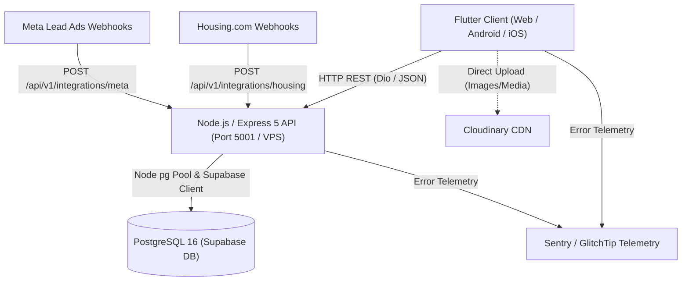
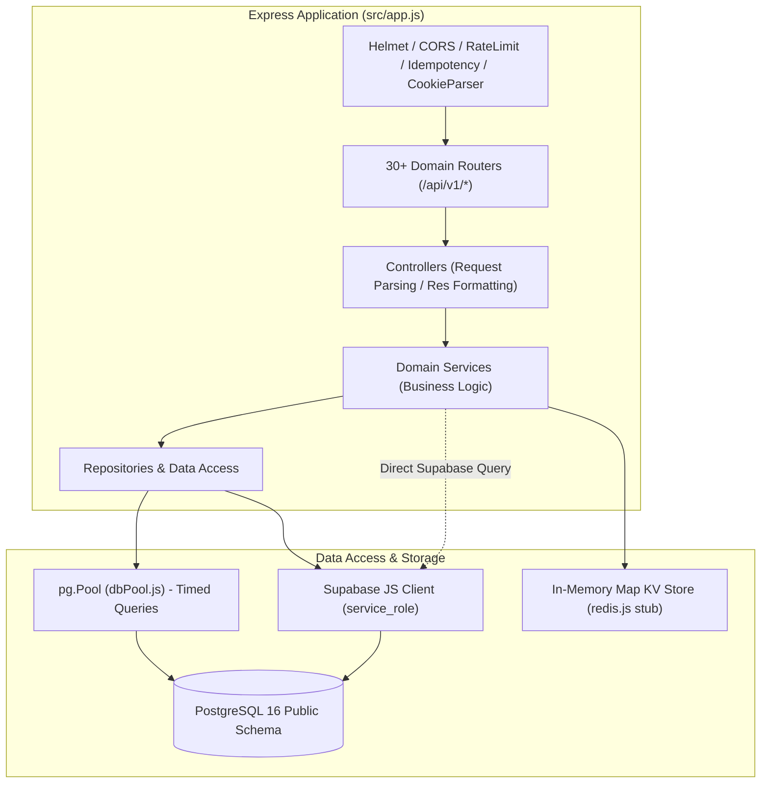

# PROPKART — CURRENT ARCHITECTURE MAP
**Version:** 1.1.0  
**Status:** FORENSIC ARCHITECTURE BASELINE (STEP 1)  
**Date:** October 19, 2026  
**Scope:** Frontend (`c:\NB\propkart`), Backend (`C:\NB\PropKart-Backend`), Database (`PostgreSQL 16 / Supabase`), Infrastructure  

---

## 1. Executive Summary & Forensic Inventory

This document establishes the exact, verified architecture of PropKart as it exists in the active codebase. PropKart is a dual-repository, multi-tenant Real Estate CRM and ERP platform serving web, mobile (Android/iOS), and desktop.

### Repository Map
- **Frontend Workspace:** `c:\NB\propkart` (Flutter 3.x / Dart 3.x)
- **Backend Workspace:** `C:\NB\PropKart-Backend` (Node.js 20+, Express 5.2.1, PostgreSQL 16)
- **Database Engine:** PostgreSQL 16 (hosted via Supabase self-hosted/cloud instance, `public` schema, port 54329 local / 5432 production)
- **Object Storage & CDN:** Cloudinary (media assets), AWS S3 SDK (prepared), Local VPS static assets
- **Error Telemetry:** Sentry / GlitchTip (dual DSN configuration)

---

## 2. Frontend Architecture (Flutter Client)

### 2.1 Entry Points & Bootstrap Flow
The Flutter application initializes through three sequential entry points:
1. `lib/main.dart` (338 lines):
   - Initializes Flutter engine bindings, Sentry error wrapping (`SentryFlutter.init`).
   - Configures `AppEnv.assertConfigured()`, sets up `IsarService.initialize()`.
   - Initializes `SecureStorage`, `ThemeManager`, `PushNotificationService`, `PeriodicWorkCoordinator`.
   - Injects global root BLoC providers (`AuthBloc`, `ThemeBloc`, `CampaignConnectionsBloc`).
   - Wraps the root widget tree in `AppShell` and mounts `MaterialApp.router` with `GoRouter`.
2. `lib/splash.dart` (485 lines):
   - Handles startup authentication validation, cached session verification, token refresh checks, minimum version checks (`/sync/status`).
   - Dispatches initial navigation to either `/login`, `/get-started`, or `/dashboard`.
3. `lib/get_started_screen.dart` (430 lines):
   - Onboarding presentation surface with brand assets and login dispatch.

### 2.2 Navigation & Routing
- **Routing Engine:** `go_router` (^17.3.0) configured in `lib/core/navigation/app_router.dart` (835 lines).
- **Route Guards & RBAC:** `RoleGuard` (`lib/core/security/role_guard.dart`) intercepts path changes, validating user role permissions (`Super Admin`, `Admin`, `Telecaller`, `Sales`) and dynamic permissions from `PermissionMatrixService`.
- **Web Navigation Strategy:** Uses path URL strategy with backward-compatible hash fragment parsing and redirect sanitization to prevent open redirect vulnerabilities (`RoleGuard.sanitizeRedirectPath`).
- **Route Inventory:** 38 distinct routes covering Auth, Dashboard, Properties, Requirements, Clients, Owners, Builders, Telecaller workspaces, Campaign inboxes, Reports, Library, Settings, and Support.

### 2.3 State Management Architecture
The frontend employs a mixed state management strategy:
1. **BLoC (Business Logic Component):**
   - 16 BLoC implementations across `lib/features/`:
     - `AuthBloc`: Authentication lifecycle, JWT tokens, MFA.
     - `DashboardBloc`, `SalesDashboardBloc`, `TelecallerDashboardBloc`: Metric presentation.
     - `PropertiesBloc`: Property catalog, filtering, pagination.
     - `RequirementsBloc`: Lead requirement matching and listing.
     - `CampaignLeadsBloc`, `CampaignConnectionsBloc`: Portal lead ingestion and connection states.
     - `LeadAllocationMonitorBloc`: Admin telecaller allocation and queue monitoring.
     - `ReportsBloc`: Reporting queries and drilldowns.
     - `UsersBloc`, `ClientsBloc`, `OwnersBloc`, `BuildersBloc`, `TelecallerLeadsBloc`, `TelecallerListBloc`.
2. **Local StatefulWidget (`setState`):**
   - Widespread usage of massive stateful widgets where UI presentation, filtering, pagination, modal dialogs, and network calls are tightly coupled inside the widget state (e.g., `requirements_screen.dart` with 15,925 lines, `campaign_leads_screen.dart` with 13,121 lines).
3. **ValueNotifiers & Streams:**
   - `SyncManager.isSyncing`, `AppNotifierService` for cross-component reactive triggers.

### 2.4 Data Layer, Repositories & Local Database
- **Local Persistence:**
  - **Isar Database (3.1.0+1):** Native desktop and mobile local embedded database (`default.isar`). Schema collections generated in `lib/core/storage/isar_collections.g.dart` (34,342 lines). Schemas: `LookupItemLocal`, `PropertyLocal`, `RequirementLocal`, `FollowupLocal`, `BuilderLocal`, `OwnerLocal`, `ClientLocal`, `OutboxLocal`, `DashboardLocal`, `CampaignLeadLocal`.
  - **Flutter Web Fallback:** Isar is disabled on web builds; `IsarService` bypasses Isar and falls back to in-memory `Map<String, dynamic>` caches in `LocalRepositories`.
  - **Key-Value & Session Storage:** `SharedPreferences` for local configuration and lookup schema versions; `FlutterSecureStorage` for encrypted JWT tokens, refresh tokens, and device identifiers.
- **Repository Implementations:**
  - Fragmented and decentralized across feature directories:
    - `lib/features/properties/repository/properties_repository.dart`
    - `lib/features/requirements/repository/requirements_repository.dart`
    - `lib/features/users/repository/users_repository.dart`
    - `lib/features/dashboard/repository/dashboard_repository.dart`
    - `lib/features/library/repository/library_repository.dart`
    - `lib/features/telecaller/data/telecaller_repository.dart`
    - `lib/core/storage/local_repositories.dart` (Isar CRUD abstractions)
    - `lib/core/storage/crm_draft_repository.dart` (Unsaved form state drafts)
    - `lib/core/storage/repository_coordinator.dart` (Coordinates multi-entity local lookups)

### 2.5 API Client & Network Infrastructure
- **Network Client:** `Dio` (^5.10.0) configured as a singleton in `lib/core/api/dio_client.dart` wrapped by `ApiClient` (`lib/core/api/api_client.dart`).
- **Interceptors:**
  - `LoggingInterceptor`: Logs HTTP requests, status codes, and latencies.
  - `FallbackInterceptor`: Handles retries and error interception.
- **Base URLs:** Controlled strictly via `lib/core/config/app_env.dart`:
  - Local Dev: `http://127.0.0.1:5001/api/v1`
  - Production VPS: `https://api-propkart.nbpropertytech.com/api/v1`

### 2.6 Offline Synchronization & Realtime
- **Offline Sync Pipeline:**
  - Implemented in `lib/core/network/sync_manager.dart` (1,068 lines) and `lib/core/network/sync_engine.dart` (270 lines).
  - Uses `OutboxLocal` Isar collection to queue offline mutations.
  - Startup synchronization fetches `/sync/status` schema version and pulls lookup tables if versions mismatch.
  - Reconciles differences via `SyncEngine.computeDiff` and executes batched writes to prevent UI freezing.
- **Realtime Transport:**
  - WebSocket connection managed in `SyncManager` with periodic ping/pong heartbeats.
  - Push notifications via Firebase Cloud Messaging (`firebase_messaging`) and `flutter_local_notifications`.

### 2.7 Telemetry & Logging
- `lib/core/utils/app_logger.dart`: Tiered logging (`d`, `i`, `w`, `e`, `sync`, `network`).
- `lib/core/storage/performance_logger.dart`: File-based performance metric recording with 1 MB cap and `.old` rotation.
- `lib/core/telemetry/audit_dwell_tracker.dart`: Tracks user screen dwell time and user journey telemetry.

---

## 3. Backend Architecture (Node.js / Express API)

### 3.1 Server Lifecycle & Entry Points
1. `src/server.js` (27 lines):
   - Invokes `checkDatabaseConnection()` to verify PostgreSQL connectivity.
   - Runs `ensureAdditiveSchema()` to guarantee mandatory columns and indexes exist.
   - Initializes `initSupabaseRealtime()` and starts `initCronScheduler()`.
   - Binds Express application (`app.js`) to `env.port` (default 5001).
2. `src/app.js` (460 lines):
   - Registers security middlewares: `helmet` (with strict CSP, frameguard, referrer policy), `cors` (supporting dynamic localhost ports and production domains), `express-rate-limit`, `idempotency()`, `compression()`, `cookieParser()`.
   - Enforces `Cache-Control: no-store` on all `/api/v1` routes.
   - Mounts 30+ domain routers.
   - Contains an inline diagnostic endpoint (`/api/v1/diagnostics/crud`) performing direct raw database queries.

### 3.2 Modular Backend Structure
The backend organizes business logic under `src/modules/`:
- `allocation/`: Lead allocation engine, telecaller capacity, round-robin cursor, stale recovery (`allocation.service.js`: 2,464 lines).
- `auth/`: Authentication, token generation, MFA, lockout, password history (`auth.controller.js`: 1,247 lines).
- `dashboard/`: Master KPI calculations, dynamic KPI queries, executive dashboards (`kpi.service.js`: 5,541 lines).
- `integrations/`: Meta Lead Ads, Housing.com, webhook processing, lead ingestion (`integrations.service.js`: 4,624 lines).
- `properties/`: Property inventory, pricing, amenities, media management (`properties.controller.js`: 1,060 lines, `properties.repository.js`: 645 lines).
- `requirements/`: Client requirement tracking, matching filters (`requirements.repository.js`: 946 lines).
- `health/`: System diagnostics, connection metrics, embedded HTML monitoring portal (`health.html.js`: 2,945 lines).
- `reports/`: Analytics aggregations, export generation (`reports.service.js`: 1,521 lines).
- `followups/`, `site_visits/`, `clients/`, `owners/`, `builders/`, `users/`, `search/`, `notifications/`, `checklist/`, `places/`, `audit/`, `share_sessions/`, `config/`, `legal/`, `team_messages/`, `usage/`, `locations/`, `campaign_connections/`, `export/`, `support/`, `sync/`, `page_controls/`.

### 3.3 Data Access Layer (Dual-Driver Anomaly)
The backend does NOT have a unified data access layer. It uses two parallel mechanisms:
1. **Direct PostgreSQL Pool (`pg.Pool` via `src/config/dbPool.js`):**
   - Configured with `max: 20`, `statement_timeout: 10000ms`, `timedQuery()` performance wrapper.
   - Used primarily for complex analytical queries, KPI calculations, transactions (`withTransaction`), and `FOR UPDATE SKIP LOCKED` concurrency locks.
2. **Supabase JavaScript Client (`@supabase/supabase-js` via `src/config/supabase.js`):**
   - Initialized with `env.supabaseServiceRoleKey` (bypasses RLS).
   - Used in multiple services and controllers for CRUD operations (`.from('table').select().insert().update()`).

### 3.4 Caching Implementation (Redis Stub)
- `src/config/redis.js`:
  - Redis was removed or disabled.
  - Replaced by an in-memory `Map` with TTL eviction (`memorySet`, `memoryGet`, `kvGet`, `kvSet`).
  - Key-value state is per-process and resets upon server restart.
  - Used for JWT denylists, refresh tokens, rate-limit lockout counters, and cache invalidation keys.

### 3.5 Background Jobs & Schedulers
- `src/services/cron.service.js`:
  - Runs periodic background tasks:
    - Periodic allocation of untouched Meta/integration leads.
    - Automated stale lead recovery (uncontacted leads returned to allocation queue).
    - Database KPI snapshot recording.
    - Daily cleanup of expired user sessions and temporary share links.

### 3.6 Error Handling & Validation
- **Errors:** Standardized error hierarchy in `src/utils/errors.js` (`AppError`, `BadRequestError`, `ValidationError`, `UnauthorizedError`, `ForbiddenError`, `NotFoundError`, `ConflictError`).
- **PostgreSQL Error Sanitizer:** `sanitizeDatabaseError()` translates Postgres error codes (`23505`, `23503`, `23502`, `40001`, `57014`) into safe domain errors without leaking database structure.
- **Validation:** Partially enforced via Zod schemas in `src/security/architecturalGuard.js` (`validateStrictPayload`) and `express-validator` middleware.

---

## 4. Database Architecture (PostgreSQL 16)

### 4.1 Schema Overview & Migration History
The database schema is managed via 57 chronological SQL migrations in `C:\NB\PropKart-Backend\sql\migrations\`.

### 4.2 Core Tables Inventory
| Domain | Primary Tables | Responsibility |
| :--- | :--- | :--- |
| **Identity & Access** | `users`, `roles`, `role_feature_permissions`, `user_feature_overrides`, `user_sessions`, `password_history`, `health_portal_admins` | Authentication, credentials, RBAC matrix, session security |
| **Multi-Tenancy** | `organizations` | Tenant boundaries, root isolation |
| **Inventory** | `properties`, `property_images`, `property_videos`, `property_amenities`, `property_types`, `property_categories`, `property_status`, `brokerage_types`, `facing_types`, `furnishing_types`, `ownership_types` | Canonical real estate listings, media assets, lookup attributes |
| **Leads & Pipeline** | `leads`, `integration_leads`, `requirements`, `requirement_areas`, `campaign_connections`, `campaign_column_settings` | Ingested buyer/tenant leads, search criteria, campaign attribution |
| **Operations** | `followups`, `campaign_lead_followups`, `campaign_lead_callbacks`, `lead_call_attempts`, `site_visits` | Communication records, callback reminders, physical visit logs |
| **Allocation Engine**| `telecaller_availability`, `allocation_round_robin`, `lead_assignment_history`, `lead_status_history` | Workload balancing, capacity limits, assignment audit ledger |
| **Stakeholders** | `clients`, `owners`, `builders` | Directory of property owners, developers, and buyer clients |
| **System & Audit** | `audit_logs`, `kpi_audit_logs`, `admin_kpi_config`, `database_snapshots`, `integration_sync_logs`, `notifications`, `checklist`, `support_issues` | Compliance records, metrics configuration, disaster recovery snapshots |

### 4.3 Database Functions & Triggers
The database contains significant operational business logic implemented in PL/pgSQL:
- **Allocation Functions:**
  - `allocate_waiting_leads(p_limit, p_org_id)`: Selects unallocated leads using `FOR UPDATE SKIP LOCKED` and distributes them across eligible telecallers.
  - `allocate_old_untouched_leads()`, `rebalance_old_untouched_leads()`: Reclaims uncalled leads.
  - `recover_stale_leads()`, `telecaller_active_workload()`.
- **Bi-Directional Sync Triggers:**
  - `trg_sync_leads_to_requirements` & `trg_sync_requirements_to_leads`: Automatically keeps `leads` and `requirements` tables synchronized.
  - `trg_sync_integration_lead_to_unified`: Syncs incoming records from `integration_leads` into canonical `leads`.
  - `trg_sync_clf_to_followups` & `trg_sync_clc_to_followups`: Syncs campaign-specific followups and callbacks into the master `followups` ledger.
  - `trg_record_lead_status_history_insert` / `update`: Audits status changes into `lead_status_history`.

### 4.4 Row Level Security (RLS) & Client Access
- **Policy 33 (`33_server_only_public_access.sql`):**
  - Explicitly revoked all table, sequence, and function access from public roles (`anon`, `authenticated`).
  - All direct PostgREST client queries are blocked at the database level.
  - All application queries are routed through Node.js backend using `service_role` or PostgreSQL connection pool.

---

## 5. External & Infrastructure Architecture

- **Hostinger VPS:** Production host for Node.js backend (`api-propkart.nbpropertytech.com`) and PostgreSQL instance.
- **Docker:** `Dockerfile` present in backend repository for containerized deployment.
- **Reverse Proxy / SSL:** Nginx reverse proxy handling SSL termination and proxying to port 5001.
- **Cloudinary CDN:** Handles storage, transformation, thumbnail generation, and delivery of property images and video walkthroughs.
- **Meta Graph API:** Realtime webhook receiver for Facebook/Instagram Lead Ads.
- **Housing.com Webhook API:** Ingestion pipeline for third-party portal leads.
- **Error Monitoring:** Sentry SDK embedded in Flutter client and Node backend; GlitchTip fallback supported.
- **Email / Password Reset:** Native deep-link redirect (`io.nbpropertytech.propkart://reset-password`) and web landing page (`https://propkart.nbpropertytech.com/reset-password`).
