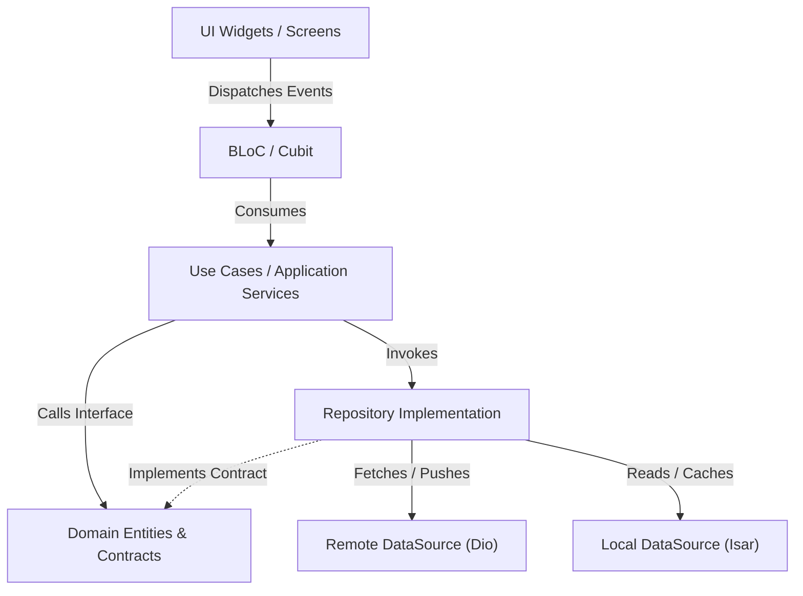
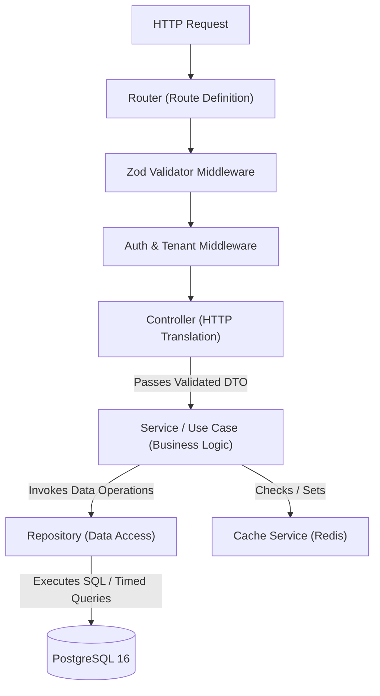

# PROPKART — TARGET ARCHITECTURE SPECIFICATION
**Version:** 2.0.0  
**Status:** CANONICAL TARGET ARCHITECTURE (STEP 1 FOUNDATION)  
**Date:** October 19, 2026  
**Scope:** PropKart Flutter Client & PropKart Backend Service  

---

## 1. Architectural Philosophy & Guiding Principles

The target architecture transitions PropKart from a monolithic, UI-coupled codebase into a clean, feature-oriented, modular architecture. 

The system adheres to four foundational architectural principles:
1. **Unidirectional Dependency Invariant:** Dependencies point inward toward the domain. Outer layers (UI, HTTP frameworks, database drivers) depend on inner abstractions (interfaces, use cases, domain models). Under no circumstances may an inner layer depend on an outer layer.
2. **Feature Isolation & Bounded Contexts:** Every business capability (Properties, Leads, Requirements, Telecaller, Reports) forms an autonomous module with an explicit public interface. Cross-feature internal imports are strictly forbidden.
3. **Single Responsibility per Class & File:** Presentation files must not contain network requests, database transactions, date parsing algorithms, or business validation logic.
4. **Isolated Testability:** Every business rule, state transition, and data transformation must be verifiable in isolation without booting UI isolates or spinning up live database instances.

---

## 2. Flutter Target Architecture

### 2.1 Directory Structure
The Flutter codebase (`lib/`) will be structured into four distinct top-level directories:

```text
lib/
├── app/
│   ├── bootstrap/            # Application lifecycle, initialization, crash reporting setup
│   ├── configuration/        # Environment configurations, feature flags, constants
│   ├── router/               # AppRouter, route definitions, redirect guards
│   └── theme/                # ThemeManager, color palettes, typography, spacing tokens
│
├── core/
│   ├── api/                  # Base HTTP client, interceptors, auth token refresh handling
│   ├── database/             # Local database driver abstractions (Isar engine lifecycle)
│   ├── errors/               # Domain failure classes, exception translators
│   ├── logging/              # Structured logging interfaces, log rotating file sink
│   ├── networking/           # Network connectivity listeners, offline status broadcast
│   ├── security/             # Role guards, token encryption, permission evaluation engine
│   ├── storage/              # Key-value persistent abstractions (SecureStorage, SharedPreferences)
│   ├── sync/                 # Master sync queue, conflict resolution engine, diffing pipeline
│   └── utils/                # Pure formatting helpers, date calculators, string validators
│
├── features/
│   ├── admin/                # Telecaller allocation monitor, system configuration
│   ├── auth/                 # Login, session restore, password reset, MFA verification
│   ├── campaign/             # Ad campaigns, Meta leads inbox, connection credentials
│   ├── clients/              # Client records, lead-to-client conversion
│   ├── dashboard/            # Executive & role-specific KPI summary cards, quick actions
│   ├── followups/            # Communication reminders, callback calendar, visit schedules
│   ├── library/              # Rental & resale public marketing assets, brochures
│   ├── owners/               # Property owner directory, property links
│   ├── properties/           # Property listings, media uploads, pricing, inventory lifecycle
│   ├── reports/              # Performance analytics, business insight charts, Excel exports
│   ├── requirements/         # Buyer/tenant requirements, matching engine integration
│   ├── settings/             # System lookups (cities, areas), role permissions, audit trails
│   ├── support/              # In-app issue ticket submission, technical helpdesk
│   ├── team_messages/        # Intra-team communication broadcasts
│   └── users/                # Employee management, attendance, role assignment
│
└── shared/
    ├── components/           # Reusable composite UI components (StatCards, FilterBars)
    ├── dialogs/              # Standard confirm, alert, and prompt dialog modals
    ├── forms/                # Form fields, address pickers, currency and phone inputs
    ├── models/               # Universal DTOs and value objects shared across features
    └── widgets/              # Atomic UI elements (Buttons, Badges, StatusChips, Skeletons)
```

### 2.2 Feature Internal Structure (Clean Architecture per Feature)
Each feature directory within `lib/features/<feature_name>/` must enforce strict 4-layer separation:

```text
features/<feature_name>/
├── presentation/
│   ├── bloc/                 # BLoC, Event, State (State management ONLY; NO UI widgets)
│   ├── screens/              # Top-level route pages (thin composers)
│   └── widgets/              # Feature-specific private widgets, dialogs, cards
│
├── application/
│   ├── usecases/             # Discrete user actions (e.g., AllocateLeadUseCase, MatchPropertiesUseCase)
│   └── facades/              # Feature public interface exposing allowed operations to other features
│
├── domain/
│   ├── entities/             # Pure Dart domain entities (immutables, Equatable)
│   ├── repositories/         # Abstract repository interfaces (contracts)
│   └── value_objects/        # Value types, status enums, business rules
│
├── data/
│   ├── datasources/
│   │   ├── remote/           # Feature API service (Dio HTTP calls)
│   │   └── local/            # Feature local DAO (Isar collection queries)
│   ├── models/               # Data models with fromJson/toJson, toDomain/fromDomain mappers
│   └── repositories/         # Concrete repository implementation coordinating remote & local
│
└── tests/                    # Feature-specific unit and widget tests
```

### 2.3 Layer Responsibility Contracts (Frontend)



#### UI & Widgets Layer (`presentation/screens`, `presentation/widgets`)
- **Permitted:** Render UI, bind to BLoC states via `BlocBuilder` / `BlocConsumer`, dispatch user action events, trigger simple navigation.
- **Strictly Prohibited:**
  - Calling API clients directly (`DioClient.dio.get(...)`).
  - Querying local databases directly (`IsarService`, `LocalRepositories`).
  - Executing business calculations (KPI aggregations, lead qualification scoring).
  - Filtering large datasets on the UI isolate via imperative loops.
  - Making authorization decisions (hardcoded role bypasses).

#### State Management Layer (`presentation/bloc`)
- **Permitted:** Receive events, manage presentation state, call application use cases, emit immutable states.
- **Strictly Prohibited:**
  - Containing Flutter UI widget definitions (`StatelessWidget`, `StatefulWidget`, `Dialog`).
  - Instantiating HTTP clients or performing raw JSON manipulation.
  - Becoming a monolithic dump for all feature logic.

#### Application & Use Case Layer (`application/usecases`)
- **Permitted:** Encapsulate a single business operation (e.g. `UpdateLeadDispositionUseCase`), validate business preconditions, coordinate one or more repository contracts.
- **Strictly Prohibited:** Depending on Flutter SDK widgets (`BuildContext`, `Widget`, `Colors`).

#### Domain Layer (`domain/`)
- **Permitted:** Pure Dart objects, business entity invariants, entity validation methods, repository interfaces.
- **Strictly Prohibited:** Importing third-party packages, Dio, Isar, or Flutter UI libraries.

#### Data Layer (`data/`)
- **Permitted:** Implement domain repository contracts, coordinate remote network calls and local cache persistence, map raw JSON/Isar entities to pure domain entities.
- **Strictly Prohibited:** Exposing database entities or network DTOs directly to the presentation layer.

---

## 3. Backend Target Architecture

### 3.1 Directory Structure
The Node.js/Express service (`src/`) will be organized into an enterprise-grade layered architecture:

```text
src/
├── config/                   # Environment validation, database pool, logger, telemetry
├── routes/                   # Centralized routing registry and API version mounts
├── controllers/              # HTTP request parsing, status codes, response marshalling
├── services/                 # Core business logic, domain workflows, allocation rules
├── repositories/             # Database access layer, SQL queries, transaction management
├── models/                   # Domain entity definitions and database schema models
├── dto/                      # Data Transfer Objects (Request/Response contracts)
├── validators/               # Zod validation schemas for payload and query parameters
├── middleware/               # Auth, tenant boundary, rate limiting, error formatting
├── database/                 # Pool configuration, migration runner, transaction helpers
├── cache/                    # Redis client and cache-aside abstraction service
├── jobs/                     # Cron schedules, background task queues, reconciliation workers
├── integrations/             # External third-party adapters (Meta Graph API, Housing.com)
├── errors/                   # Standardized domain error classes and HTTP translators
├── logging/                  # Pino/Winston structured logging and correlation IDs
├── security/                 # Cryptography, JWT verification, tenant isolation guards
└── utils/                    # Pure string, date, array, and math utility helpers
```

### 3.2 Backend Layer Responsibility Contracts



#### Routes Layer (`src/routes/`)
- **Responsibility:** Route path registration, HTTP method binding, middleware pipeline attachment.
- **Rules:** Zero business logic. Must only forward to controller methods.

#### Controllers Layer (`src/controllers/`)
- **Responsibility:**
  - Extract validated request parameters (`req.params`, `req.query`, `req.body`, `req.user`).
  - Call domain service methods with typed inputs.
  - Return standardized HTTP responses using `ApiResponse` (`res.status(200).json(...)`).
  - Catch unexpected errors and pass to `handleControllerError` or next error middleware.
- **Rules:** Controllers MUST NOT construct SQL queries, mutate database records directly, or calculate business metrics.

#### Services Layer (`src/services/`)
- **Responsibility:**
  - Enforce all business rules, lifecycle invariants, and transactional workflows.
  - Coordinate multiple repositories within atomic database transactions (`withTransaction`).
  - Interact with cache abstractions (`cacheService.get`, `cacheService.set`).
  - Trigger domain events and notification dispatches.
- **Rules:** Services MUST NOT access raw HTTP objects (`req`, `res`). Services must be completely decoupled from the transport protocol.

#### Repositories Layer (`src/repositories/`)
- **Responsibility:**
  - Execute PostgreSQL queries via the database pool (`dbPool.query`, `timedQuery`).
  - Apply mandatory multi-tenant scoping (`organization_id = $1`).
  - Map database rows to domain models / DTOs.
  - Manage database row-level locking (`FOR UPDATE SKIP LOCKED`).
- **Rules:** Repositories MUST NOT contain UI formatting, HTTP awareness, or cross-domain business rules.

#### Cache Layer (`src/cache/`)
- **Responsibility:**
  - Encapsulate Redis connections, key namespacing, serialization, and TTL policies behind a clean `CacheService` interface.
  - Provide fallback behavior when cache infrastructure is unavailable.
- **Rules:** Direct Redis client calls from services or controllers are strictly prohibited.

---

## 4. Architectural Boundaries & Migration Isolation

To prevent breaking existing production operations during transformation:
1. **Public Facade Contracts:** Features communicating across boundaries must do so exclusively via exported Facade services (e.g. `PropertiesPublicFacade.getPropertySummary(id)`).
2. **Strangler Fig Migration:** New features and decomposed modules must be written to the target architecture immediately. Legacy monolith files will be systematically refactored in scheduled steps without altering external API contracts.
3. **Database Integrity Isolation:** No changes to the underlying database table schemas or API payload contracts will be made during Step 1.
