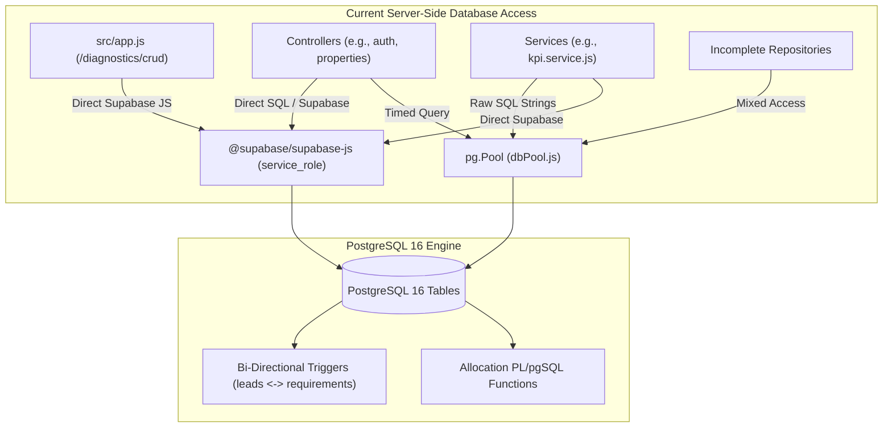
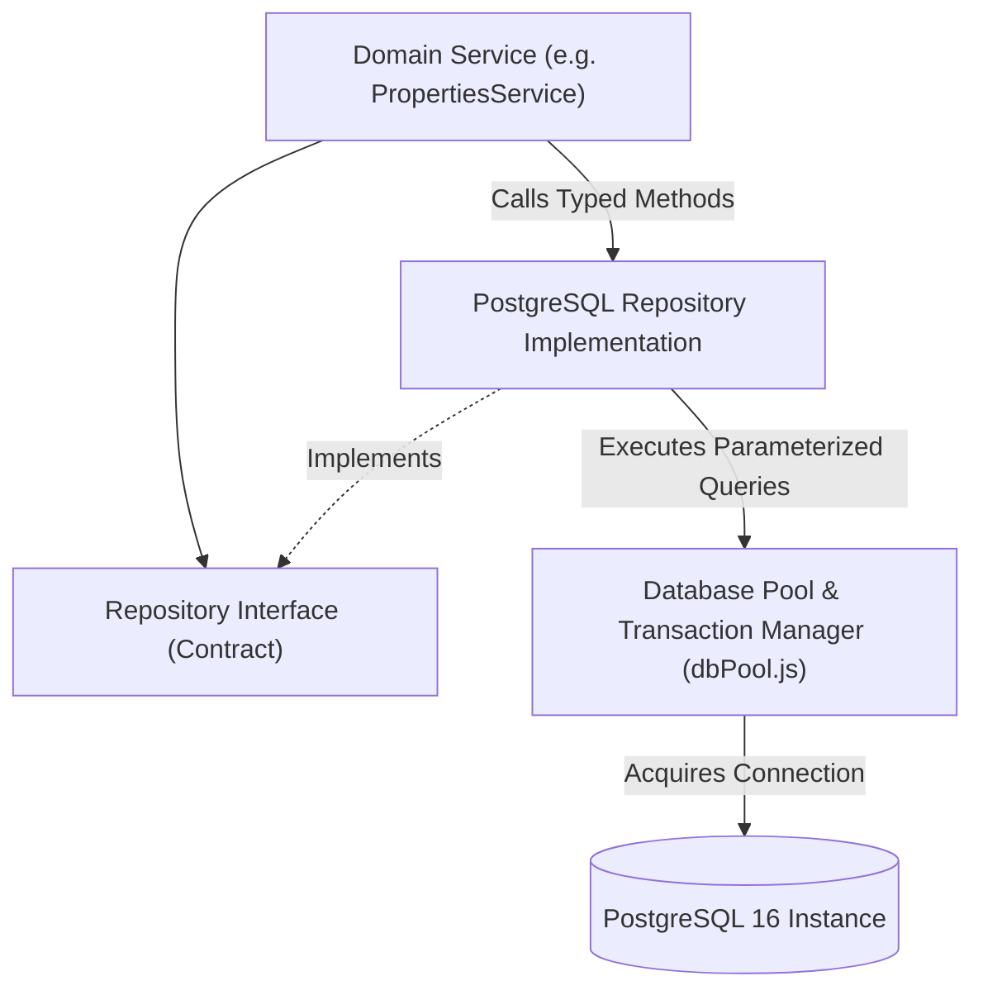

# PROPKART — DATABASE BOUNDARY & DATA ACCESS ARCHITECTURE
**Version:** 1.0.0  
**Status:** CANONICAL ARCHITECTURE BASELINE (STEP 1 FOUNDATION)  
**Date:** October 19, 2026  
**Scope:** PostgreSQL Access, Client Isolation, Driver Boundaries & Stored Logic  

---

## 1. Client Database Boundary (Flutter Client)

### 1.1 Strict Prohibition of Direct Server Database Access
In PropKart, **the Flutter client is strictly prohibited from accessing server PostgreSQL or Supabase database tables directly for normal application operations**.

### 1.2 Forensic Verification & Migration 33 Enforcement
Forensic code scanning confirms that:
1. `pubspec.yaml` contains zero dependencies on `supabase_flutter` or native PostgreSQL drivers.
2. The entire `lib/` directory contains zero SQL query strings (`SELECT`, `INSERT`, `UPDATE`, `DELETE`).
3. **Database Security Hardening (Migration 33):** In migration `33_server_only_public_access.sql`:
   - All permissions on `public` schema tables, sequences, and functions were explicitly revoked from client roles (`anon`, `authenticated`, `PUBLIC`).
   - Row Level Security (RLS) remains enabled on all tables as defense-in-depth, while direct PostgREST client endpoint access is completely blocked.
   - All server queries are executed exclusively by the Node.js backend using the privileged `service_role` or direct PostgreSQL pool credentials.

---

## 2. Server-Side Database Boundary & Forensic Deficiencies

While the client boundary is clean, the server-side database access layer exhibits significant architectural fragmentation:

### 2.1 The Dual-Driver Anomaly (`pg.Pool` vs `@supabase/supabase-js`)
The backend currently utilizes **two competing database client drivers**:
1. `pg.Pool` (`src/config/dbPool.js`):
   - Direct PostgreSQL connection pool with connection timeout, statement timeout (10s), and `timedQuery()` performance logging.
   - Used in `kpi.service.js`, `allocation.service.js`, `databaseCheck.js`, and multi-table transactions (`withTransaction`).
2. `@supabase/supabase-js` (`src/config/supabase.js`):
   - High-level PostgREST client wrapping HTTP queries via `service_role`.
   - Used in `app.js`, `integrations.service.js`, `allocation.service.js`, and several controller files.

**Architectural Defect:**  
Maintaining two separate database drivers creates dual connection overhead, disparate connection pool limits, inconsistent transaction isolation, and split error handling schemas.

### 2.2 Direct Database Access in Controllers & App.js
- In `src/app.js` (lines 204–375), an inline diagnostic endpoint (`/api/v1/diagnostics/crud`) directly queries and mutates the `checklist` and `users` tables using the Supabase client.
- Multiple controllers bypass the repository layer and execute database queries directly instead of delegating to domain services.

### 2.3 Massive Raw SQL Queries in Domain Services
- `src/modules/dashboard/kpi.service.js` contains over **5,000 lines of raw SQL string concatenations**, embedding complex database column projections, joins, and aggregations directly inside service methods.
- Services should express business intent; raw SQL composition belongs strictly within dedicated repository implementations.

---

## 3. Database Triggers & Stored Procedure Logic

A critical finding in the PropKart database architecture is the heavy reliance on **database-level operational business logic**:

### 3.1 PL/pgSQL Lead Allocation Engine
Core operational algorithms are executed inside PostgreSQL stored functions:
- `allocate_waiting_leads(p_limit, p_org_id)`
- `allocate_old_untouched_leads()`
- `rebalance_old_untouched_leads()`
- `recover_stale_leads()`
- `telecaller_active_workload(p_user_id)`

**Architectural Assessment:**
- **Positive:** These functions utilize PostgreSQL `FOR UPDATE SKIP LOCKED` row-level locks, guaranteeing zero duplicate lead allocations under high concurrent traffic.
- **Risk:** Stored procedure logic is difficult to unit test, lacks modern CI/CD linting, cannot be stepped through with Node.js debuggers, and couples platform scalability tightly to PostgreSQL CPU utilization.

### 3.2 Recursive Bi-Directional Sync Triggers
The schema contains multiple automated synchronization triggers:
1. `trg_sync_leads_to_requirements` (`fn_sync_leads_to_requirements`): Synchronizes lead phone, customer name, and status to the corresponding `requirements` record.
2. `trg_sync_requirements_to_leads` (`fn_sync_requirements_to_leads`): Synchronizes requirement changes back to the parent `leads` table.
3. `trg_sync_integration_lead_to_unified`: Copies records from `integration_leads` into canonical `leads`.
4. `trg_sync_clf_to_followups` & `trg_sync_clc_to_followups`: Syncs campaign followups and callbacks to the master `followups` ledger.

**Architectural Assessment & Known Defect:**
- **Risk of Infinite Loops:** While guard clauses exist (`pg_trigger_depth()`), bi-directional triggers risk circular firing, lock contention, and unpredictable side effects during bulk imports or migrations.
- **Hidden Side Effects:** Developers updating a lead in code are often unaware that three other tables are mutated automatically by database triggers.

---

## 4. Multi-Tenant Isolation at the Database Layer

### 4.1 Mandatory Organization Scoping
PropKart is a multi-tenant platform. Every business table (`leads`, `requirements`, `properties`, `users`, `followups`, `site_visits`, `clients`, `owners`) contains an `organization_id` column.

### 4.2 Architectural Rule Enforcement (`src/security/architecturalGuard.js`)
- Every query constructed by the backend must explicitly include `organization_id = $1`.
- `assertTenantContext(user, resourceOrgId)` validates that no user can read or mutate resources belonging to another organization.
- Super Admins are granted cross-tenant visibility only when explicitly requested (`crossTenant: true`).

---

## 5. Target Data-Access Architecture

### 5.1 Single Driver Unification
- Unify all backend database access under the direct PostgreSQL pool driver (`pg.Pool`), standardizing on parameterized queries, automated statement timeouts (10s), and slow query logging (>500ms).
- Phase out `@supabase/supabase-js` usage within the backend application layer.

### 5.2 Repository Isolation Mandate
- Every database table or aggregate root must have a single authoritative repository in `src/repositories/` (e.g., `PropertiesRepository`, `LeadsRepository`, `RequirementsRepository`).
- Zero SQL strings permitted in controllers or domain services.
- All database mutations involving more than one table must be wrapped in `withTransaction(async (client) => { ... })`.
