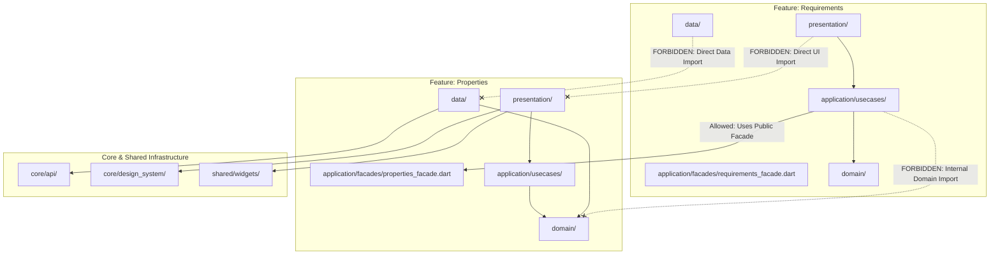

# PROPKART — AI-AGENT MAINTAINABLE ARCHITECTURE
**Version:** 1.0.0  
**Status:** CANONICAL ARCHITECTURE STANDARD (STEP 1 FOUNDATION)  
**Date:** October 19, 2026  
**Scope:** AI-Agent Autonomy, Context Isolation & Localized Feature Engineering  

---

## 1. Architectural Motivation: The AI Agent Context Boundary

When human engineers or Autonomous AI Coding Agents (such as DeepMind Antigravity) work on a feature, a primary constraint is the **Cognitive Context Window**:
- In the legacy architecture, modifying a single field in the "Requirements" form requires reading `requirements_screen.dart` (15,925 lines), `app_shell.dart` (3,846 lines), `properties_screen.dart` (6,860 lines), and `kpi.service.js` (5,541 lines). This exceeds token limits, increases latency, and causes unintended regressions.
- In the **AI-Agent Friendly Target Architecture**, the system is decomposed so that an AI agent can execute a complete, robust feature modification (e.g. adding a new property amenity or modifying lead disposition logic) by inspecting **less than 1,200 lines across 3–4 localized files**, without needing to understand the global application.

---

## 2. The 5-Layer Autonomous Feature Standard

Every feature in `lib/features/<feature_name>/` adheres to a self-contained 5-layer hierarchy:

```text
features/<feature_name>/
├── presentation/             # UI, BLoC, and Local Dialogs
│   ├── bloc/                 # Feature-specific state machines
│   ├── screens/              # Scaffold entry points (<400 lines)
│   └── widgets/              # Atomic, single-responsibility widgets (<250 lines)
│
├── application/              # Business Use Cases & Cross-Feature Facades
│   ├── usecases/             # Single-action command/query handlers
│   └── facades/              # Public API exposed to other features
│
├── domain/                   # Enterprise Business Rules & Entities
│   ├── entities/             # Pure Dart domain models
│   ├── repositories/         # Abstract repository contracts
│   └── value_objects/        # Enums, validation rules, invariants
│
├── data/                     # Data Access & Persistence
│   ├── datasources/          # Remote (Dio) and Local (Isar) data providers
│   ├── models/               # DTOs with JSON/Isar serializers
│   └── repositories/         # Concrete repository implementations
│
└── tests/                    # Feature Unit & Widget Tests
    ├── presentation/         # Widget and BLoC tests
    ├── application/          # Use case tests
    └── data/                 # Repository and mapper tests
```

---

## 3. Allowed vs Forbidden Dependencies per Feature



### 3.1 Allowed Dependencies
- A feature may freely import its own internal layers following the inward dependency rule (`presentation` $\rightarrow$ `application` $\rightarrow$ `domain` $\leftarrow$ `data`).
- A feature may import `core/` infrastructure (API client, design system tokens, formatters, logging).
- A feature may import `shared/` universal widgets and composite components.
- A feature may interact with another feature **ONLY through that feature's public Facade** (`application/facades/<feature>_facade.dart`).

### 3.2 Forbidden Dependencies
- **Forbidden:** Feature A importing private widgets, screens, or dialogs from Feature B (`import '../../properties/screens/properties_screen.dart'`).
- **Forbidden:** Feature A importing concrete data repositories or local database schemas from Feature B.
- **Forbidden:** Feature A modifying the BLoC state of Feature B directly.
- **Forbidden:** A feature data layer importing Flutter UI packages (`package:flutter/material.dart`).

---

## 4. Standard Feature Public Facade Pattern

When Feature B needs data or actions from Feature A, Feature A must export an explicit Facade:

```dart
// lib/features/properties/application/facades/properties_facade.dart

abstract class PropertiesFacade {
  /// Returns a lightweight summary of an active property listing.
  Future<PropertySummaryEntity?> getPropertySummary(String propertyId);

  /// Checks if a property matches given price and bedroom constraints.
  Future<bool> checkPropertyAvailability(String propertyId);

  /// Stream of property status change events for external listeners.
  Stream<PropertyStatusChangedEvent> get onPropertyStatusChanged;
}
```

**Benefits for AI Agents:**
1. When an AI agent is working on `requirements`, it only needs to read `PropertiesFacade` (approx. 40 lines) to interact with properties, rather than parsing 6,860 lines of `properties_screen.dart`.
2. Any breaking changes to `properties` that affect `requirements` are immediately caught by the typed Facade contract.

---

## 5. Standard Naming & Organization Conventions

To ensure zero cognitive ambiguity for automated agents, all PropKart code must adhere to strict naming conventions:

| Entity Type | File Suffix / Pattern | Example Path |
| :--- | :--- | :--- |
| **Top-Level Screen** | `*_screen.dart` | `presentation/screens/property_detail_screen.dart` |
| **Screen Widget** | `*_widget.dart`, `*_card.dart` | `presentation/widgets/property_amenity_chips.dart` |
| **Modal / Dialog** | `*_dialog.dart`, `*_sheet.dart`| `presentation/dialogs/confirm_reserve_dialog.dart` |
| **BLoC Machine** | `*_bloc.dart` | `presentation/bloc/property_detail_bloc.dart` |
| **BLoC Event / State** | `*_event.dart`, `*_state.dart` | `presentation/bloc/property_detail_event.dart` |
| **Application Use Case**| `*_usecase.dart` | `application/usecases/reserve_property_usecase.dart` |
| **Domain Entity** | `*_entity.dart` | `domain/entities/property_entity.dart` |
| **Repository Contract** | `*_repository.dart` | `domain/repositories/properties_repository.dart` |
| **Repository Impl** | `*_repository_impl.dart` | `data/repositories/properties_repository_impl.dart` |
| **Data Model (DTO)** | `*_model.dart` | `data/models/property_dto.dart` |
| **Remote DataSource** | `*_api_service.dart` | `data/datasources/remote/properties_api_service.dart` |
| **Local DataSource** | `*_local_dao.dart` | `data/datasources/local/properties_local_dao.dart` |

---

## 6. Self-Documenting Feature README Protocol

Every feature directory must contain a standardized `README.md` defining its bounded context:

```markdown
# Feature: Properties Inventory

## Responsibilities
- Manages residential and commercial property inventory.
- Handles media asset uploads (images/videos) to Cloudinary.
- Tracks property lifecycle states (Available, Under Offer, Rented, Sold).

## Public Facade Interface
- `PropertiesFacade.dart`

## Key Domain Invariants
- `INV-PROP-01`: A property cannot be moved to 'Sold' without a verified buyer client ID.
- `INV-PROP-02`: Price must be a non-negative decimal.

## Unit Test Coverage Location
- `features/properties/tests/`
```

An AI agent entering the workspace reads `features/<name>/README.md` and immediately has the complete mental model for that feature in under 100 lines.
