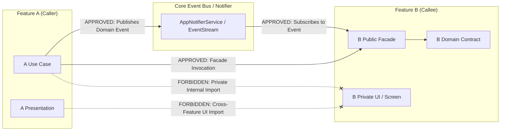

# PROPKART — CROSS-FEATURE DEPENDENCY RULES & BOUNDARIES
**Version:** 1.0.0  
**Status:** CANONICAL GOVERNANCE CONTRACT (STEP 1 FOUNDATION)  
**Date:** October 19, 2026  
**Scope:** Dependency Direction, Layer Isolation & Cross-Feature Coupling  

---

## 1. Absolute Dependency Direction Rules

Dependencies in PropKart must flow strictly in accordance with Clean Architecture and Domain-Driven Design boundaries. Dependencies must never point upward or bypass intermediate abstraction layers.

```text
Presentation Layer (UI / Widgets / Screens)
      ↓ depends on
Presentation State (BLoC / Cubit)
      ↓ depends on
Application Layer (Use Cases / Facades)
      ↓ depends on
Domain Layer (Entities / Repository Contracts)
      ↑ implemented by
Data Layer (Repositories / Remote & Local DataSources)
      ↓ depends on
Core Infrastructure (HTTP Client / Isar Driver / Secure Storage)
```

### Inviolable Invariants:
1. **The Inward Invariant:** Outer rings depend on inner rings. Domain never imports Application, Presentation, Data, or Flutter UI.
2. **The Core Isolation Invariant:** `lib/core/` is foundational infrastructure. **`lib/core/` must NEVER import anything from `lib/features/` or `lib/modules/`**.
3. **The Feature Bounded Context Invariant:** Features must not reach into the private implementation files (`presentation/`, `data/`) of other features.
4. **The No-Circular-Dependency Invariant:** Circular imports (`A` $\rightarrow$ `B` $\rightarrow$ `A`) are strictly forbidden.

---

## 2. Permitted vs Forbidden Cross-Feature Communication



### 2.1 Approved Cross-Feature Communication Mechanisms
When a business operation requires collaboration across two features (e.g. converting a Lead in `campaign` into an active Requirement in `requirements`):

1. **Mechanism 1: Public Feature Facade (Synchronous Requests)**  
   The calling feature injects the target feature's abstract Facade (`FeaturesFacade`). The Facade handles internal feature coordination and returns a typed DTO or entity.
2. **Mechanism 2: Domain Event Bus (Decoupled Asynchronous Notifications)**  
   When a state transition occurs (e.g., `LeadAllocatedEvent`), the originating feature publishes the event to the centralized `AppNotifierService` / event stream. Interested features subscribe to the event stream without direct compile-time coupling.
3. **Mechanism 3: Shared Core/Domain Value Objects**  
   Universal primitive entities (e.g. `Address`, `PhoneNumber`, `Money`, `UserIdentity`) reside in `lib/shared/models/` and may be shared across all features.

### 2.2 Strictly Forbidden Anti-Patterns
```text
Properties UI  ------(FORBIDDEN DIRECT IMPORT)------>  Dashboard UI
Requirements Screen  -(FORBIDDEN DIRECT IMPORT)----->  Properties Service
Campaign Leads  -----(FORBIDDEN DIRECT IMPORT)------>  Users Repository Internal
Core Network Sync  --(FORBIDDEN INWARD IMPORT)------>  15+ Feature Models & Services
BLoC State Machine --(FORBIDDEN UPWARD IMPORT)------>  Flutter UI Widgets & Dialogs
```

---

## 3. Forensic Catalog of Current Dependency Violations

### Violation 1: Core Inward Contamination (`SyncManager`)
- **File:** `lib/core/network/sync_manager.dart` (lines 13–31).
- **The Defect:** `SyncManager` is located in `lib/core/network/`, yet it directly imports 15 feature files:
  - `../../features/properties/models/property_model.dart`
  - `../../features/properties/services/properties_service.dart`
  - `../../features/requirements/models/requirement_model.dart`
  - `../../features/requirements/services/requirements_service.dart`
  - `../../features/dashboard/models/dashboard_summary.dart`
  - `../../features/builders/models/builder_model.dart`
  - `../../features/owners/models/owner_model.dart`
  - `../../features/clients/models/client_model.dart`
  - `../../features/campaign/bloc/campaign_connections_bloc.dart`
- **Architectural Impact:** Complete architectural inversion. Infrastructure in `core/` cannot be compiled, tested, or reused independently because it is bound to the entire application.
- **Remediation Plan:** Refactor `SyncManager` to accept registered `SyncParticipant` interfaces. Each feature registers its own sync participant with `SyncManager` at application startup.

### Violation 2: UI Contamination inside BLoC State Machines
- **File:** `lib/features/admin/bloc/lead_allocation_monitor_bloc.dart` (lines 1–15, 254–2303).
- **The Defect:** The BLoC file directly imports UI tokens (`AppColors`, `AppBreakpoints`), UI headers (`CRMPageHeader`), and dialogs (`TelecallerDetailDialog`), and defines the entire 2,050-line `LeadAllocationMonitorScreen` widget tree inside the BLoC file.
- **Architectural Impact:** Violates the separation between Presentation and State Management. BLoC cannot be tested in headless environments without loading Flutter widget libraries.
- **Remediation Plan:** Separate `LeadAllocationMonitorScreen` into `presentation/screens/` and leave only the pure BLoC state machine in `presentation/bloc/`.

### Violation 3: Cross-Feature Coupling in Monolithic Screens
- **File:** `lib/features/requirements/screens/requirements_screen.dart` (lines 18–48).
- **The Defect:** `requirements_screen.dart` imports `PropertiesRepository`, `PropertiesService`, `PropertyModel`, `DashboardRepository`, `DashboardSummary`, `UsersBloc`, `UsersRepository`, and `TeamMessagesService`.
- **Architectural Impact:** Any change to the Properties or Dashboard data contracts risks breaking the Requirements screen.
- **Remediation Plan:** Mediate cross-feature interactions via `PropertiesFacade` and `UsersFacade`.

### Violation 4: Backend Service-to-Service Cross Coupling
- **File:** `src/modules/dashboard/kpi.service.js` (lines 13–15).
- **The Defect:** `kpi.service.js` directly imports `AllocationService` and `IntegrationsService`.
- **Architectural Impact:** Tight coupling among the three largest services in the backend (5,500 + 2,400 + 4,600 = 12,500 lines).
- **Remediation Plan:** Repositories must provide raw data queries; KPI calculations should consume repository interfaces rather than invoking monolithic peer services.
