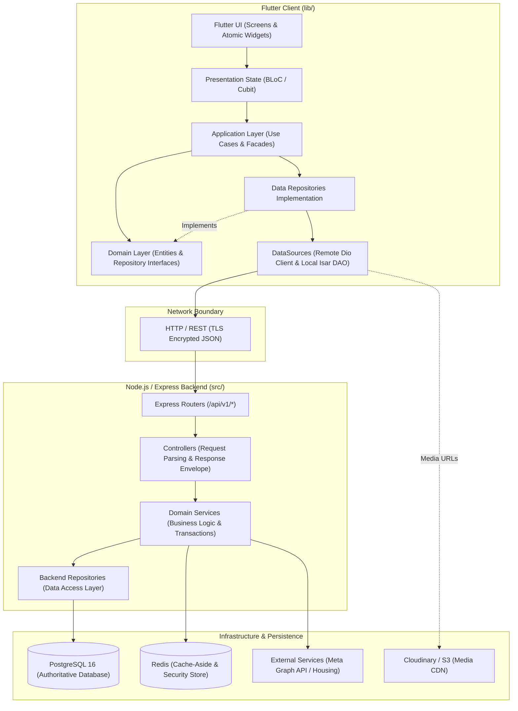
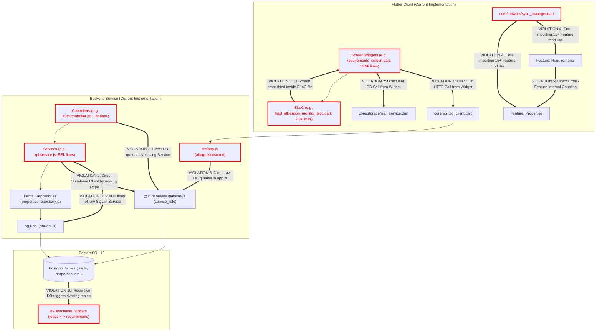

# PROPKART — SYSTEM DEPENDENCY GRAPH & VIOLATIONS MAP
**Version:** 1.0.0  
**Status:** CANONICAL DEPENDENCY GRAPH (STEP 1 FOUNDATION)  
**Date:** October 19, 2026  
**Scope:** End-to-End System Flow & Visual Violation Registry  

---

## 1. Target End-to-End Dependency Flow

In the target architecture, dependencies flow strictly downward and inward. No layer may skip intermediate tiers or point upward.

---

## 2. Current Architecture Flow with Active Violations

The current implementation contains multiple severe architectural violations where components skip layers, invert dependency flow, or bypass isolation boundaries entirely:

---

## 3. Cataloged Violation Details

| Violation ID | Component From | Component To | Description & Risk | Target Layer Resolution |
| :--- | :--- | :--- | :--- | :--- |
| **VIO-01** | `requirements_screen.dart` | `DioClient` | Widget executes direct HTTP requests (`DioClient.dio.get`). Prevents offline queuing, unit testing, and breaks UI responsiveness. | Must call `RequirementsBloc` -> `RequirementsRepository`. |
| **VIO-02** | `requirements_screen.dart` | `LocalRepositories` | Widget queries local Isar database directly within `setState`. Couples UI to local schema. | Must read from `RequirementsRepository` abstraction. |
| **VIO-03** | `lead_allocation_monitor_bloc.dart` | `LeadAllocationMonitorScreen` | The entire 2,050-line UI screen is embedded inside the BLoC file. Impossible to test BLoC headlessly. | Extract UI into `presentation/screens/`. BLoC file contains state machine only. |
| **VIO-04** | `core/network/sync_manager.dart` | `features/*/models & services` | Core infrastructure imports 15 feature directories. Severe architectural inversion. | Invert dependency: Features register `SyncParticipant` interfaces with core. |
| **VIO-05** | `features/requirements/` | `features/properties/` | Requirements screen directly imports `PropertiesRepository` and `PropertiesService` internal files. | Mediate access via `PropertiesFacade`. |
| **VIO-06** | `src/app.js` | `@supabase/supabase-js` | Diagnostic endpoint (`/diagnostics/crud`) executes direct database mutations inside application root bootstrap file. | Relocate logic to `health.controller.js` and `health.service.js`. |
| **VIO-07** | `src/modules/auth/auth.controller.js` | PostgreSQL | Controller performs password hashing, token creation, and database writes directly. | Move logic to `auth.service.js` and `users.repository.js`. |
| **VIO-08** | `src/modules/dashboard/kpi.service.js` | `pg.Pool` | Domain service builds 5,000+ lines of raw SQL string concatenations. | Move SQL compositions to `kpi.repository.js`. Service computes business metrics. |
| **VIO-09** | Backend Application | `@supabase/supabase-js` & `pg.Pool` | Split database drivers causing duplicate connection overhead and inconsistent transactions. | Deprecate Supabase client in backend; unify on `pg.Pool` with `timedQuery`. |
| **VIO-10** | PostgreSQL `leads` | PostgreSQL `requirements` | Bi-directional triggers automatically mutate sibling tables, creating circular lock risks and hidden side-effects. | Transition table synchronization to the backend application service layer. |
