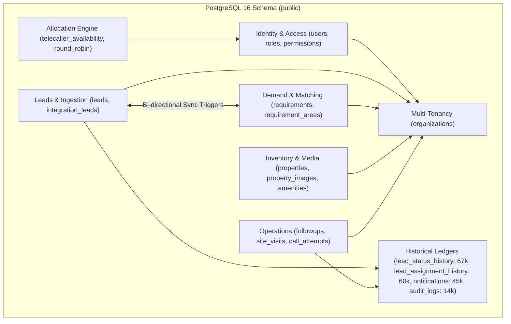

# PROPKART — DATABASE CURRENT STATE BASELINE
**Version:** 1.0.0  
**Status:** CANONICAL DATABASE BASELINE (STEP 2)  
**Date:** October 20, 2026  
**Scope:** PostgreSQL 16 Production Schema (`public`), Port 54329 (Local) / 5432 (VPS Production)  

---

## 1. Executive Summary & Forensic Topology

A complete automated catalog inspection of PostgreSQL was conducted on October 20, 2026. The database contains **83 tables** in the `public` schema, **41 active triggers**, **57 applied schema migrations**, and approximately **195,000 active database records** totaling **120 MB** on disk.

### Global PostgreSQL Engine Characteristics
- **Engine Version:** PostgreSQL 16.x (PostGIS / UUID-OSSP / pgcrypto enabled)
- **Default Isolation Level:** Read Committed
- **Timezone Storage:** 100% of timestamp columns are standardized as `timestamp with time zone` (`timestamptz`). Zero non-timezone timestamps found.
- **Client Access Control:** Direct client PostgREST access is strictly revoked (`33_server_only_public_access.sql`). All queries executed via backend `service_role` or `pg.Pool`.



---

## 2. Table Inventory & Domain Decomposition

The 83 tables in the database are classified into 8 functional domains:

| Domain | Table Count | Key Tables | Active Row Count | Total Size |
| :--- | :---: | :--- | :---: | :---: |
| **1. Historical Event Ledgers** | 4 | `lead_status_history`, `lead_assignment_history`, `notifications`, `audit_logs` | **188,397** | **105 MB** |
| **2. Demand & Ingestion** | 5 | `leads`, `integration_leads`, `requirements`, `requirement_areas`, `campaign_connections` | **3,749** | **18.8 MB** |
| **3. Property Inventory & Media**| 14 | `properties`, `property_images`, `property_amenities`, `property_videos`, `amenities`, `areas`, `cities` | **2,503** | **1.2 MB** |
| **4. Operations & Followups** | 6 | `followups`, `lead_call_attempts`, `campaign_lead_followups`, `campaign_lead_callbacks`, `site_visits`, `internal_crm_remarks` | **2,347** | **1.4 MB** |
| **5. Identity, Access & Tenancy**| 12 | `users`, `roles`, `organizations`, `role_feature_permissions`, `user_sessions`, `user_device_tokens` | **85** | **480 kB** |
| **6. Allocation Engine** | 4 | `telecaller_availability`, `allocation_round_robin`, `admin_kpi_config`, `property_upload_limits` | **35** | **360 kB** |
| **7. System Configuration & Support**| 18 | `page_development_controls`, `support_issues`, `database_snapshots`, `checklist`, `legal_documents` | **120** | **520 kB** |
| **8. Deprecated / Dropped Bloat**| 20 | `form_fields`, `form_submissions`, `deleted_properties`, `export_history`, `import_history` | **49** | **580 kB** |

---

## 3. Detailed Specification of Critical Business Tables

### 3.1 Table: `leads`
```text
Table: public.leads
Purpose: Canonical master customer intake entity for all inbound lead generation channels (Meta Ads, Housing.com, Webhooks, and direct manual entry).
Primary Key: id (uuid, default gen_random_uuid())
Foreign Keys:
  - organization_id -> organizations(id) [ON DELETE CASCADE]
  - category_id -> property_categories(id)
  - property_type_id -> property_types(id)
  - configuration_id -> configurations(id)
  - listing_type_id -> listing_types(id)
  - city_id -> cities(id)
  - area_id -> areas(id)
  - assigned_telecaller_id -> users(id)
  - assigned_to -> users(id)
  - created_by -> users(id)
  - admin_id -> users(id)
Important Columns:
  - source (varchar, NOT NULL)
  - external_lead_id (varchar, nullable, Meta leadgen ID or Housing ID)
  - customer_name (varchar)
  - phone (varchar), sanitized_phone (varchar)
  - lead_type (varchar, NOT NULL, default 'Requirement')
  - stage (varchar, NOT NULL, default 'NEW') ['NEW', 'INTERESTED', 'SALES', 'SITE_VISIT', 'LISTED', 'WON', 'LOST', 'ARCHIVED']
  - allocation_status (varchar, NOT NULL, default 'UNASSIGNED_WAITING') ['UNASSIGNED_WAITING', 'ASSIGNED_TO_TELECALLER', 'HANDED_TO_SALES', 'CALLBACK', 'CNR', 'DIRECT_SALES', 'FOLLOWUP']
  - call_disposition (varchar, NOT NULL, default 'NOT_ATTEMPTED')
  - priority (varchar, NOT NULL, default 'NORMAL')
  - waiting_since (timestamptz, NOT NULL, default NOW())
  - raw_json (jsonb, NOT NULL, default '{}')
  - created_at (timestamptz), updated_at (timestamptz), deleted_at (timestamptz)
Indexes:
  - leads_pkey (UNIQUE on id)
  - idx_leads_allocation_queue (organization_id, priority, waiting_since) WHERE allocation_status = 'UNASSIGNED_WAITING' AND deleted_at IS NULL
  - idx_leads_assigned_to_active (assigned_to) WHERE deleted_at IS NULL AND assigned_to IS NOT NULL
  - idx_leads_kpi_perf (lead_type, source, allocation_status, stage, assigned_telecaller_id, assigned_to, created_at) WHERE deleted_at IS NULL
  - idx_leads_legacy_requirement_id (legacy_requirement_id) WHERE legacy_requirement_id IS NOT NULL
  - idx_leads_telecaller_active_workload (assigned_telecaller_id, allocation_status, stage) WHERE deleted_at IS NULL
Constraints:
  - Primary key on id
  - Foreign keys to organizations, users, lookup tables
Relationships:
  - Has many: lead_status_history, lead_assignment_history, followups, lead_call_attempts, site_visits
  - 1-to-1 sync: requirements (mirrored via fn_sync_leads_to_requirements)
Read Patterns: High frequency (Telecaller queue, Admin dashboard, Ingestion deduplication, Reports)
Write Patterns: Continuous write (Webhooks, telecaller call logs, allocation engine updates)
Approximate Row Count: 1,395 active rows
Growth Pattern: ~5,000 - 15,000 rows/month based on marketing ad spend
Critical Queries: Ingest deduplication by phone; Allocation queue dequeuing; KPI aggregations
KPI Usage: Total Leads, Contacted Leads, Qualified Leads, Allocation counts
Sync Usage: Replicated to Flutter client via REST and Isar `CampaignLeadLocal`
Risk: Missing B-Tree index on `phone` and `sanitized_phone` causes sequential scans on every webhook arrival.
```

---

### 3.2 Table: `requirements`
```text
Table: public.requirements
Purpose: Buyer and tenant property search profiles and consultation requirements.
Primary Key: id (uuid, default gen_random_uuid())
Foreign Keys:
  - organization_id -> organizations(id)
  - category_id -> property_categories(id)
  - property_type_id -> property_types(id)
  - configuration_id -> configurations(id)
  - listing_type_id -> listing_types(id)
  - city_id -> cities(id)
  - area_id -> areas(id)
  - assigned_to -> users(id)
  - created_by -> users(id)
  - telecaller_id -> users(id)
Important Columns:
  - customer_name (varchar, NOT NULL)
  - mobile (varchar, NOT NULL)
  - budget_from (numeric), budget_to (numeric), budget (double precision)
  - status (varchar, NOT NULL, default 'Active')
  - configuration_ids (uuid[]), property_type_ids (uuid[]), furnishing_type_ids (uuid[])
  - created_at, updated_at, deleted_at (timestamptz)
Indexes:
  - requirements_pkey (UNIQUE on id)
  - idx_requirements_mobile (mobile)
  - idx_requirements_organization_id (organization_id)
  - idx_requirements_telecaller_id (telecaller_id)
  - idx_requirements_assignment (assigned_to) WHERE deleted_at IS NULL
  - idx_requirements_assigned_to_active (assigned_to) WHERE deleted_at IS NULL AND assigned_to IS NOT NULL
  - idx_requirements_budget (budget_from, budget_to) WHERE deleted_at IS NULL
  - idx_requirements_matching (city_id, area_id, status) WHERE deleted_at IS NULL
  - idx_requirements_meta_custom_fields (GIN on meta_custom_fields)
  - idx_requirements_meta_lead_id (UNIQUE on meta_lead_id) WHERE meta_lead_id IS NOT NULL
Constraints: Primary Key, FKs, NOT NULL constraints on customer_name, mobile, status
Relationships:
  - Has many: requirement_areas, internal_crm_remarks, followups, site_visits, share_sessions
  - Bi-directional sync with: leads
Read Patterns: High frequency (Requirements screen, Property Matching Engine, Sales Pipeline)
Write Patterns: Frequent updates during telecaller and sales agent consultations
Approximate Row Count: 689 active rows
Growth Pattern: 1:1 with requirement-type leads (~2,000 - 5,000/month)
Critical Queries: Property matching queries; Sales representative pipeline queries
KPI Usage: Active Requirements, Deal Won counts
Sync Usage: Full offline replication into Isar `RequirementLocal`
Risk: Column `budget` stored as `double precision` while `budget_from`/`budget_to` and `properties.price` are `numeric`, causing implicit cast overhead in matching queries.
```

---

### 3.3 Table: `properties`
```text
Table: public.properties
Purpose: Canonical master inventory of real estate properties (Apartments, Villas, Commercial, Plots) available for Rent or Resale.
Primary Key: id (uuid, default gen_random_uuid())
Foreign Keys:
  - organization_id -> organizations(id)
  - category_id -> property_categories(id)
  - property_type_id -> property_types(id)
  - configuration_id -> configurations(id)
  - listing_type_id -> listing_types(id)
  - property_status_id -> property_status(id)
  - brokerage_type_id -> brokerage_types(id)
  - city_id -> cities(id)
  - area_id -> areas(id)
  - created_by -> users(id)
  - closed_by -> users(id)
Important Columns:
  - property_code (varchar, unique generated code e.g. PR-1002)
  - title (varchar, NOT NULL)
  - price (numeric, NOT NULL)
  - brokerage (numeric)
  - bedrooms (int), bathrooms (int), balconies (int)
  - super_builtup_area (numeric), carpet_area (numeric)
  - latitude (numeric), longitude (numeric)
  - section (varchar) ['residential', 'commercial']
  - created_at, updated_at, deleted_at (timestamptz)
Indexes:
  - properties_pkey (UNIQUE on id)
  - idx_properties_code (property_code) WHERE deleted_at IS NULL
  - idx_properties_filters (category_id, listing_type_id, property_status_id) WHERE deleted_at IS NULL
  - idx_properties_geo_search (city_id, area_id) WHERE deleted_at IS NULL
  - idx_properties_kpi_perf (property_status_id, listing_type_id, created_at) WHERE deleted_at IS NULL
  - idx_properties_price (price) WHERE deleted_at IS NULL
  - idx_properties_organization_id (organization_id)
  - idx_properties_ownership (created_by) WHERE deleted_at IS NULL
  - idx_properties_brokerage (brokerage) WHERE brokerage IS NOT NULL
  - idx_properties_brokerage_type (brokerage_type_id)
  - idx_properties_google_place_id (google_place_id)
  - idx_properties_owner_mobile (owner_mobile)
  - idx_properties_section (section) WHERE section IS NOT NULL
Constraints: Primary Key, Check constraints on price $\ge 0$
Relationships:
  - Has many: property_images, property_videos, property_amenities, site_visits, share_session_properties
Read Patterns: High read volume (Public catalog, Search, Broker views, PDF brochure generation)
Write Patterns: Low-to-moderate write volume (Inventory intake, price updates, status changes)
Approximate Row Count: 186 active properties
Growth Pattern: ~100 - 300 properties/month
Critical Queries: Multi-filter inventory search; Matching algorithm; Available inventory KPI
KPI Usage: Available Inventory, Total Portfolio, Properties Sourced by Sales/Telecallers
Sync Usage: Fully replicated to Isar `PropertyLocal`
Risk: Missing index on `property_images(property_id)` forces sequential scan whenever loading media for any property.
```

---

### 3.4 Table: `site_visits`
```text
Table: public.site_visits
Purpose: Immutable historical ledger tracking physical client visits to properties.
Primary Key: id (uuid, default gen_random_uuid())
Foreign Keys:
  - organization_id -> organizations(id)
  - property_id -> properties(id)
  - requirement_id -> requirements(id)
  - lead_id -> leads(id)
  - sales_user_id -> users(id)
  - scheduled_by -> users(id)
Important Columns:
  - visit_date (date, NOT NULL)
  - time_slot (varchar)
  - status (varchar, NOT NULL) ['Pending', 'COMPLETED', 'Cancelled', 'Rescheduled']
  - outcome (varchar) ['INTERESTED', 'REJECTED_AFTER_VISIT', 'DEAL_WON', null]
  - agent_notes (text)
  - completed_at (timestamptz)
Indexes:
  - site_visits_pkey (UNIQUE on id)
  - idx_site_visits_property_id (property_id)
  - idx_site_visits_requirement_id (requirement_id)
  - idx_site_visits_lead_id (lead_id)
  - idx_site_visits_sales_user_id (sales_user_id)
  - idx_site_visits_status_dates (status, visit_date, completed_at)
  - idx_site_visits_completed_outcome (status, outcome, completed_at)
  - idx_site_visits_org_completed (organization_id, status, completed_at)
  - uq_site_visits_req_completed (UNIQUE on requirement_id, completed_at) WHERE requirement_id IS NOT NULL AND completed_at IS NOT NULL
Constraints: Unique booking constraint preventing duplicate visits
Relationships: Links leads, requirements, properties, and sales executives
Read Patterns: Daily review (Sales agent agenda, Site Visit KPI cards, Conversion metrics)
Write Patterns: Appends on scheduling; Updates status/outcome upon completion
Approximate Row Count: 29 rows
Growth Pattern: ~200 - 500 visits/month
Critical Queries: `site_visits_done` KPI (`WHERE UPPER(status) = 'COMPLETED'`)
KPI Usage: Canonical source of truth for Site Visits Done KPI
Sync Usage: Transient BLoC state
Risk: Low. Well-indexed after Migration 38 & 39.
```

---

### 3.5 Table: `notifications`
```text
Table: public.notifications
Purpose: User notification messages and system alerts (Lead assigned, Visit scheduled, Mention).
Primary Key: id (uuid, default gen_random_uuid())
Foreign Keys: user_id -> users(id)
Important Columns:
  - user_id (uuid, NOT NULL)
  - title (varchar, NOT NULL)
  - message (text, NOT NULL)
  - is_read (boolean, NOT NULL, default false)
  - data (jsonb)
  - created_at (timestamptz, default NOW())
Indexes:
  - notifications_pkey (UNIQUE on id)
Constraints: Primary Key, FK on user_id
Read Patterns: Extremely high frequency (Every client app boot, background polling, UI notification bell)
Write Patterns: Continuous append (System events, webhook allocations)
Approximate Row Count: 45,902 rows (12 MB)
Growth Pattern: ~15,000 - 30,000 rows/month
Critical Queries: `SELECT count(*) FROM notifications WHERE user_id = $1 AND is_read = false`
KPI Usage: None
Sync Usage: Realtime stream to Flutter client
Risk: **CRITICAL VULNERABILITY (P0)**: Only index is PK `(id)`. Every unread count query performs a sequential scan of 45,902 rows (1,412 buffers).
```

---

### 3.6 Table: `lead_assignment_history`
```text
Table: public.lead_assignment_history
Purpose: Immutable ledger recording every lead transfer, telecaller assignment, and queue rebalance.
Primary Key: id (uuid, default gen_random_uuid())
Foreign Keys:
  - lead_id -> leads(id)
  - organization_id -> organizations(id)
  - from_telecaller_id -> users(id)
  - to_telecaller_id -> users(id)
  - assigned_by -> users(id)
Important Columns:
  - assignment_type (varchar) ['AUTOMATIC', 'MANUAL_REASSIGN', 'STALE_RECOVERY', 'OLD_UNTOUCHED']
  - reason (text)
  - assigned_at (timestamptz, default NOW())
Indexes:
  - lead_assignment_history_pkey (UNIQUE on id)
  - idx_lead_assignment_history_lead (lead_id, assigned_at DESC)
  - idx_lead_assignment_history_org (organization_id, assigned_at DESC)
Read Patterns: High frequency (Admin allocation monitor, Telecaller workload calculation, Peer transfer sync)
Write Patterns: Append on every allocation event
Approximate Row Count: 60,314 rows (13 MB)
Growth Pattern: High (~20,000 rows/month)
Critical Queries: `telecaller_active_workload` function; Telecaller transfer audit
Risk: **HIGH (P0)**: Lacks index on `to_telecaller_id`. Querying assignments for an executive requires scanning 60,314 rows.
```

---

## 4. Catalog of Deprecated & Dropped Bloat Tables

The architectural guard (`src/security/architecturalGuard.js`) prohibits querying or creating shadow tables. The following 10 dropped bloat tables still physically exist in the database with 0 rows:
- `deleted_properties` (0 rows, 72 kB)
- `deleted_property_amenities` (0 rows, 8 kB)
- `deleted_property_images` (0 rows, 16 kB)
- `deleted_property_videos` (0 rows, 16 kB)
- `form_fields` (26 rows, legacy form builder experiment)
- `form_sections` (6 rows)
- `form_submissions` (3 rows)
- `form_versions` (1 row)
- `forms` (1 row)
- `submission_media` (6 rows)
- `submission_audit_logs` (7 rows)
- `submission_telecaller_notes` (4 rows)
- `service_agent_documents` (0 rows)
- `export_history` (0 rows)
- `import_history` (0 rows)

**Governance Policy:** Soft deletion is standardized using `deleted_at IS NULL`. Shadow clone tables are permanently banned. Legacy form experiment tables are scheduled for clean decommissioning in future multi-release deprecation protocols.
