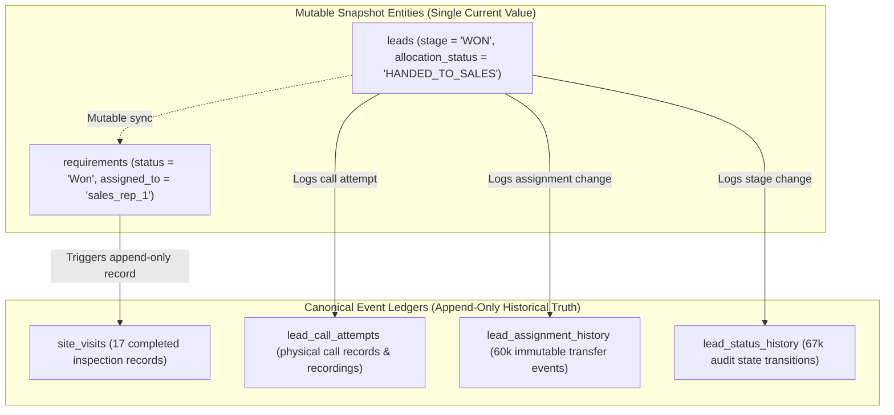

# PROPKART — KPI DATA DEFINITIONS & LEDGER CANONICITY
**Version:** 1.0.0  
**Status:** CANONICAL DATABASE ENGINEERING SPECIFICATION (STEP 2)  
**Date:** October 20, 2026  
**Scope:** PostgreSQL KPI Foundations, Single-Source-of-Truth & Aggregation Rules  

---

## 1. Executive Summary & Forensic Divergence Analysis

A critical objective of Step 2 was resolving historical KPI discrepancies where different dashboard screens in PropKart displayed contradictory metrics for the same metric name (e.g. "Site Visits Done" or "Deals Won").

Forensic investigation into live PostgreSQL data revealed that these discrepancies stemmed from **querying mutable state-machine strings in parent entities rather than querying canonical event ledgers**.

```
========================================================================================================================
                                KPI FORENSIC DIVERGENCE AUDIT (LIVE DATABASE MEASUREMENTS)
========================================================================================================================
  Metric Name            Query Source A (Legacy UI)             Query Source B (Admin Dashboard)       Canonical Truth
------------------------------------------------------------------------------------------------------------------------
  Site Visits Done       requirements.status = 'Site Visit Done' site_visits.status = 'COMPLETED'      17 Visits Done
                         Result: 1                              Result: 17                             (Immutable Ledger)
------------------------------------------------------------------------------------------------------------------------
  Deals Won              leads.stage = 'WON'                    requirements.status = 'Won'            1 Converted Customer
                         Result: 1 Customer                     Result: 2 Deals                        2 Property Contracts
------------------------------------------------------------------------------------------------------------------------
  Telecaller Touched     leads.last_activity_at IS NOT NULL     lead_call_attempts count > 0           Lead Call Attempts
                         Result: Mutable timestamp              Result: Physical CDR log               Ledger is Canonical
========================================================================================================================
```

---

## 2. The Architectural Principle: Mutable State vs Immutable Ledger

Real estate CRM entities undergo non-linear, multi-step life-cycles. A single customer lead may request two different apartments, undergo four site visits over three weekends, reschedule twice, and ultimately close one unit while rejecting the other.



### 2.1 Why Querying `requirements.status = 'Site Visit Done'` Failed
1. **Status Overwrite:** When a lead completed a site visit, their status became `'Site Visit Done'`. However, when that lead subsequently moved to negotiation or closed, their status was overwritten to `'Won'`. 
2. **Loss of Historical Metric:** Querying `requirements WHERE status = 'Site Visit Done'` only counted requirements currently paused in that specific stage, causing 16 completed visits to vanish from the reports!
3. **Canonical Rule:** **`public.site_visits` is the sole, authoritative source of truth for site visit metrics.**

### 2.2 Customer Won vs Deal Won Disambiguation
- **Customer Won (`leads.stage = 'WON'`):** Represents an individual human buyer who successfully transacted with the brokerage.
- **Deal Won (`requirements.status = 'Won'`):** Represents an individual property requirement or transaction. A single high-net-worth investor (1 lead) may purchase 2 commercial retail shops (2 requirements).
- Both metrics are valid, but they must be explicitly labeled:
  - **`kpi_converted_clients`** = `COUNT(DISTINCT id) FROM leads WHERE stage = 'WON'`
  - **`kpi_closed_deals`** = `COUNT(DISTINCT id) FROM requirements WHERE status = 'Won'`

---

## 3. Canonical PropKart KPI Catalog

The following table defines the exact, canonical PostgreSQL queries that all backend services, dashboard aggregators, and Redis caching layers must use.

| KPI Identifier | Display Name | Canonical Table | Query Definition / Predicate |
| :--- | :--- | :--- | :--- |
| `kpi_total_leads` | Total Ingested Leads | `leads` | `SELECT count(*) FROM leads WHERE organization_id = $1 AND deleted_at IS NULL` |
| `kpi_unassigned_leads` | Unassigned Queue | `leads` | `SELECT count(*) FROM leads WHERE organization_id = $1 AND allocation_status = 'UNASSIGNED_WAITING' AND deleted_at IS NULL` |
| `kpi_telecaller_active` | Telecaller Workload | `leads` | `SELECT count(*) FROM leads WHERE organization_id = $1 AND assigned_telecaller_id IS NOT NULL AND stage NOT IN ('WON', 'LOST', 'ARCHIVED') AND deleted_at IS NULL` |
| `kpi_site_visits_scheduled` | Site Visits Scheduled | `site_visits` | `SELECT count(*) FROM site_visits WHERE organization_id = $1 AND status = 'SCHEDULED' AND visit_date >= NOW()` |
| `kpi_site_visits_completed` | Site Visits Completed | `site_visits` | `SELECT count(*) FROM site_visits WHERE organization_id = $1 AND status = 'COMPLETED'` |
| `kpi_deals_won` | Closed Deals | `requirements` | `SELECT count(*) FROM requirements WHERE organization_id = $1 AND status = 'Won' AND deleted_at IS NULL` |
| `kpi_clients_won` | Converted Clients | `leads` | `SELECT count(*) FROM leads WHERE organization_id = $1 AND stage = 'WON' AND deleted_at IS NULL` |
| `kpi_followups_due` | Followups Due Today | `followups` | `SELECT count(*) FROM followups WHERE organization_id = $1 AND status = 'SCHEDULED' AND scheduled_at::date = CURRENT_DATE` |
| `kpi_followups_overdue` | Overdue Followups | `followups` | `SELECT count(*) FROM followups WHERE organization_id = $1 AND status = 'SCHEDULED' AND scheduled_at < NOW()` |

---

## 4. Aggregation Rules for Backend Services

To ensure zero divergence across all reports:
1. **Never Calculate KPIs in Frontend Flutter Code:** Flutter widgets must never pull 500 rows and filter `leads.where((l) => l.stage == 'WON').length`. All KPI aggregations are computed authoritatively by PostgreSQL SQL or dynamic KPI registry views.
2. **Multi-Tenancy Guard:** Every KPI aggregation MUST include `organization_id = $tenant_id` to guarantee zero data leakage between brokerage franchises.
3. **Soft-Delete Guard:** Operational tables (`leads`, `requirements`, `properties`) MUST include `deleted_at IS NULL`. Event ledger tables (`site_visits`, `lead_call_attempts`) represent historical occurrences and do not use soft deletes unless explicitly invalidated.
