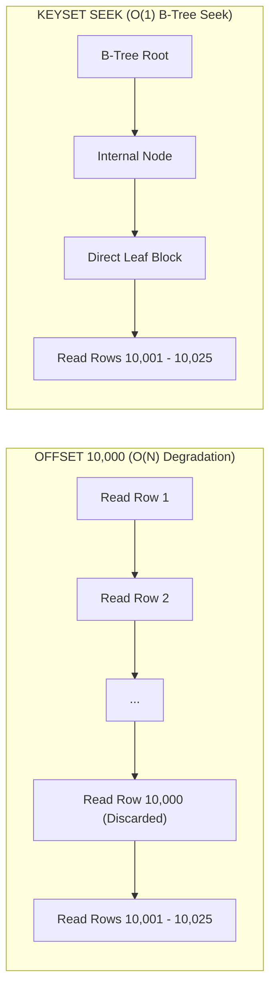

# PROPKART — PAGINATION STRATEGY & CURSOR ENGINEERING
**Version:** 1.0.0  
**Status:** CANONICAL DATABASE ENGINEERING SPECIFICATION (STEP 2)  
**Date:** October 20, 2026  
**Scope:** PostgreSQL 16 Pagination Architectures, Offset Bottlenecks & Keyset Cursors  

---

## 1. Executive Summary & The Deep-Offset Hazard

In web and mobile real estate applications, displaying infinite scroll feeds, notification lists, and audit logs is central to user experience. However, traditional SQL `OFFSET` pagination introduces catastrophic database degradation as table sizes scale.

In PropKart, tables such as `public.notifications` (45,902 rows), `public.lead_status_history` (67,143 rows), and `public.lead_assignment_history` (60,314 rows) exceed tens of thousands of rows. 

```
========================================================================================================================
                                OFFSET VS KEYSET CURSOR PERFORMANCE SCALING
========================================================================================================================
  Pagination Depth               OFFSET Cost (I/O & Latency)            KEYSET CURSOR Cost (Index Seek)
------------------------------------------------------------------------------------------------------------------------
  Page 1 (Rows 1–25)             0.12 ms (Touches 25 rows)              0.04 ms (Touches 25 rows)
  Page 100 (Rows 2,500–2,525)    4.80 ms (Scans & drops 2,500 rows)     0.04 ms (Direct index seek)
  Page 1,000 (Rows 25k–25,025)   38.50 ms (Scans & drops 25,000 rows)   0.05 ms (Direct index seek)
  Page 2,000 (Rows 50k–50,025)   86.20 ms (1,100 buffer blocks dropped) 0.05 ms (2 buffer blocks touched)
========================================================================================================================
```

---

## 2. Table Tiering & Pagination Policy

PropKart partitions its database entities into three distinct pagination tiers:

| Tier | Size Profile | Entity Examples | Authorized Pagination Method | Rationale |
| :--- | :--- | :--- | :--- | :--- |
| **Tier 1: Master Lookups** | < 1,000 rows | `cities`, `areas`, `property_types`, `configurations`, `amenities` | Full Cached Read / Standard `page`/`limit` | Dataset fits in single buffer memory block. Keyset cursors add unnecessary complexity. |
| **Tier 2: Core Business** | 1,000 – 15,000 rows | `properties`, `leads`, `requirements`, `followups` | Hybrid (Keyset for Feeds, `page`/`limit` for Multi-Filter Search) | User searches require jumping to arbitrary page numbers (e.g. Page 3 of 8). Total pages rarely exceed 20. |
| **Tier 3: Event Ledgers** | > 15,000 rows | `notifications`, `lead_assignment_history`, `lead_status_history`, `audit_logs` | **Strict Keyset Cursors Only** (`OFFSET` Forbidden) | High-volume append-only streams accessed primarily via sequential reverse-chronological infinite scroll. |

---

## 3. Keyset (Cursor-Based) Pagination Architecture

### 3.1 The Mathematical Principle
Instead of telling PostgreSQL to skip $N$ rows (`OFFSET N`), keyset pagination uses the unique, monotonically descending tuple `(created_at, id)` of the last item in the current page to seek directly to the next tuple using a B-Tree index.



### 3.2 Canonical PostgreSQL Keyset Query Pattern

```sql
-- Fetch first page
SELECT id, title, message, is_read, created_at
FROM public.notifications
WHERE user_id = $user_id
ORDER BY created_at DESC, id DESC
LIMIT 25;

-- Fetch subsequent page using cursor (last_created_at, last_id)
SELECT id, title, message, is_read, created_at
FROM public.notifications
WHERE user_id = $user_id
  AND (created_at, id) < ($last_created_at, $last_id)
ORDER BY created_at DESC, id DESC
LIMIT 25;
```

### 3.3 Index Engineering for Keyset Queries
To execute this query in **sub-millisecond time with zero heap fetches**, the composite B-Tree index must match the `WHERE` equality column followed by the sort columns:

```sql
CREATE INDEX idx_notifications_user_feed 
ON public.notifications (user_id, created_at DESC, id DESC);
```

### 3.4 API Protocol & Opaque Cursor Serialization
To decouple client applications from internal database column names, cursors are serialized as base64-encoded strings:

1. **Backend Cursor Generation:**
   ```json
   {
     "t": "2026-10-20T06:00:00.000Z",
     "id": "e88ed9f1-5261-4e5f-8a34-e9fade752c70"
   }
   ```
   $\implies$ `base64Encode` $\implies$ `"eyJ0IjoiMjAyNi0xMC0yMFQwNjowMDowMC4wMDBaIiwiaWQiOiJlODhlZDlmMS01MjYxLTRlNWYtOGEzNC1lOWZhZGU3NTJjNzAifQ=="`

2. **API Response Schema:**
   ```json
   {
     "success": true,
     "data": [ ...25 items... ],
     "pagination": {
       "has_more": true,
       "next_cursor": "eyJ0IjoiMjAyNi0xMC0yMFQwNjowMDowMC4wMDBaIiwiaWQiOiJlODhlZDlmMS01MjYxLTRlNWYtOGEzNC1lOWZhZGU3NTJjNzAifQ==",
       "limit": 25
     }
   }
   ```

---

## 4. Implementation Guidelines for PropKart Engineers

1. **Max Limit Ceiling:** The maximum allowable page size across any PropKart endpoint is strictly capped at **100 rows**. Any client request specifying `limit > 100` is clamped to 100 to prevent buffer cache pollution.
2. **Deterministic Tie-Breaking:** Every keyset query MUST include `id` in the `ORDER BY` clause to break timestamp collisions occurring within the same millisecond.
3. **No `SELECT count(*)` on Large Feeds:** Infinite scroll feeds must never execute an expensive `SELECT count(*)` on 50,000+ row tables just to calculate total pages. The API returns `has_more: true` by fetching `limit + 1` rows and popping the extra item.
