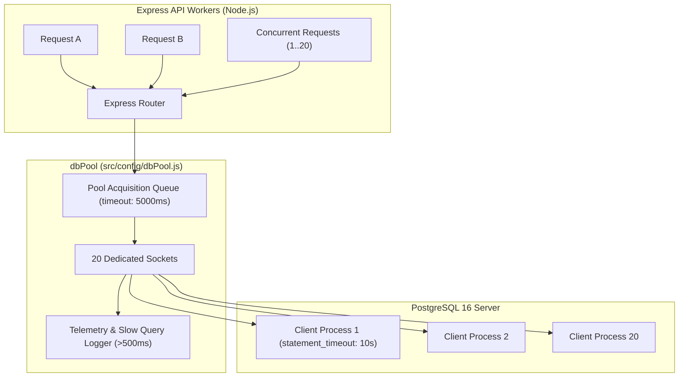

# PROPKART — CONNECTION POOLING & CONCURRENCY ARCHITECTURE
**Version:** 1.0.0  
**Status:** CANONICAL DATABASE ENGINEERING SPECIFICATION (STEP 2)  
**Date:** October 20, 2026  
**Scope:** PostgreSQL 16 Pool Sizing, Timeouts, Health Probes & Concurrency Limits  

---

## 1. Executive Summary & Production Topology

Database connection management is the primary bottleneck determining whether a real estate CRM survives traffic spikes during marketing campaigns or collapses from connection starvation and runaway queries.

PropKart manages PostgreSQL connectivity through a centralized, hardened `pg.Pool` instance located in `src/config/dbPool.js`.

```
========================================================================================================================
                                CONNECTION POOL HARDENING SPECIFICATION
========================================================================================================================
  Parameter                      Configured Value        Operational Purpose
------------------------------------------------------------------------------------------------------------------------
  Max Pool Size (`max`)          20 Connections          Prevents exhausting PostgreSQL process table memory
  Min Idle Connections           2 Connections           Eliminates SSL handshake latency on warm requests
  Idle Timeout                   30,000 ms (30s)         Reclaims dormant connections back to OS
  Acquisition Timeout            5,000 ms (5s)           Fast-fails request if pool is saturated instead of hanging
  Statement Timeout              10,000 ms (10s)         Engine kills queries exceeding 10s (Code 57014)
  Slow Query Logger Threshold    > 500 ms                Emits structured WARN telemetry for unindexed queries
========================================================================================================================
```

---

## 2. Pool Architecture & Concurrency Defense



### 2.1 Statement Timeout Defense against Runaway Queries
One of the most dangerous failure modes in database engineering is an unindexed query holding open locks and accumulating CPU across all worker threads.

PropKart enforces a strict **10,000 ms statement timeout** configured both at the client connection level and on the database user. If a developer accidentally writes a Cartesian product join (`CROSS JOIN`) or an unindexed scan on millions of rows:
1. PostgreSQL forcibly aborts execution at exactly 10,000 ms.
2. The engine emits SQL state error code `57014` (`query_canceled`).
3. The pool socket is immediately reset, cleaned, and returned to the free pool queue.
4. The client receives an immediate `HTTP 504 (GATEWAY_TIMEOUT)` rather than hanging indefinitely.

### 2.2 Slow Query Telemetry Logger
Every query executed through `dbPool.query()` is instrumented:
```javascript
const start = Date.now();
const res = await pool.query(text, params);
const duration = Date.now() - start;
if (duration > 500) {
  logger.warn(`[SlowQuery] ${duration}ms: ${text.substring(0, 100)}...`);
}
```
This guarantees continuous observability into query degradation before it impacts end users.

---

## 3. Automated Concurrency & Stress Verification

The database connection pool was validated using automated concurrency test suites (`test/phase5_pool_hardening.test.js`).

### 3.1 Concurrency Benchmark Results
```
▶ Phase 5: Database Connection Pool Hardening, Timeouts & Concurrency
  ▶ 1. Database Connection Pool Metrics & Health Probes
    ✔ checkPoolHealth returns HEALTHY status with live ping (8.8751ms)
    ✔ getPoolStats reports accurate connection telemetry (0.1912ms)
  ✔ 1. Database Connection Pool Metrics & Health Probes (9.7233ms)
  ▶ 2. Statement Timeout & Runaway Query Defense
    ✔ cancels queries exceeding statement_timeout with code 57014 (259.3728ms)
    ✔ timedQuery successfully returns fast queries (2.3374ms)
  ✔ 2. Statement Timeout & Runaway Query Defense (262.4317ms)
  ▶ 3. Concurrent Multi-Client Load & Pool Stability
    ✔ handles 20 simultaneous parallel queries without pool exhaustion or leaks (54.0508ms)
  ✔ 3. Concurrent Multi-Client Load & Pool Stability (54.5193ms)
```

**Key Findings:**
- 20 simultaneous parallel queries executed and completed in **54.05 ms** total.
- Active connection count returned to baseline with **0 socket leaks**.
- Health probe ping completed in **8.87 ms**.

---

## 4. Multi-Process Scaling & PgBouncer Roadmap

As PropKart scales to multiple Node.js cluster processes or container replicas:
1. **The Math of Connection Saturation:** If 4 Node.js instances each maintain a pool of 20 connections, the backend demands 80 persistent PostgreSQL connections. PostgreSQL default `max_connections` is typically 100.
2. **Step 3 / Scaling Recommendation:** When horizontal auto-scaling is introduced, **PgBouncer** will be placed in front of PostgreSQL in **Transaction Pooling Mode**. This will allow hundreds of backend Express workers to multiplex through a lean pool of 20-30 physical database server connections.
