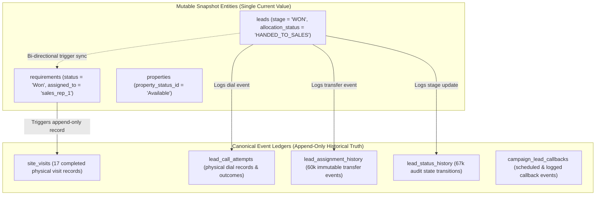

# PROPKART — KPI SOURCE-OF-TRUTH & CANONICAL LEDGER SPECIFICATION
**Step:** 8.0 — Baseline & Canonical Definition Audit  
**Version:** 1.0.0  
**Date:** October 20, 2026  
**Role:** Lead Data Architect + KPI/Analytics Architect + Systems Auditor  
**Status:** CANONICAL AUDIT BASELINE  

---

## 1. The Fundamental Architectural Principle: Mutable State vs. Immutable Ledgers

The central discovery of this forensic audit is that historical KPI divergence in PropKart is caused by querying **mutable state-machine snapshot entities** rather than querying **canonical event ledgers**.

Real estate CRM entities undergo non-linear, multi-step life cycles:
- A single buyer lead may submit three different apartment inquiries.
- A client may conduct 4 physical site visits over 3 weekends, reschedule twice, and eventually close on 1 unit while rejecting the others.
- A lead may transition through `NEW` -> `CONTACTED` -> `QUALIFIED` -> `SITE_VISIT` -> `NEGOTIATION` -> `WON`.



### 1.1 Why Querying Mutable Status Strings Fails
1. **Status Overwrite (Historical Erasure):** When a prospective buyer completes a physical walkthrough, their requirement status is temporarily updated to `'Site Visit Done'`. However, when that requirement subsequently advances to price negotiation or closes, its status column is overwritten with `'Negotiation'` or `'Won'`.
2. **Resulting Discrepancy:** Querying `requirements WHERE status = 'Site Visit Done'` only counts requirements **currently stuck in that specific phase**, missing all successfully advanced visits!
   - In our live database test: `requirements.status = 'Site Visit Done'` returned **1**, whereas the canonical `site_visits` ledger table recorded **17 completed visits**! 16 physical site visits had vanished from the reports.
3. **The Ledger Principle:** **Append-only historical event ledgers are the SOLE authoritative source of truth for historical operational metrics.**

### 1.2 Customer Won vs. Closed Deal Disambiguation
- **Customer Converted (`leads.stage = 'WON'`):** Represents an individual human consumer who completed a successful transaction with PropKart.
- **Closed Deal (`requirements.status = 'Won'`):** Represents an individual property transaction or brokerage contract. A single client (1 lead) may acquire 2 residential plots (2 requirements/deals).
- Both metrics are valid and valuable, but they must be explicitly disambiguated in the data architecture and UI:
  - `kpi_converted_clients` = `COUNT(DISTINCT id) FROM leads WHERE stage = 'WON'` (Live measurement: **1**)
  - `kpi_closed_deals` = `COUNT(DISTINCT id) FROM requirements WHERE status = 'Won'` (Live measurement: **3**)

---

## 2. Canonical Source-of-Truth Matrix

The following matrix defines the **authoritative database source**, **entity classification**, **canonical query predicate**, **primary timestamp column**, and **soft-delete rules** for all core PropKart operational metrics.

| Metric Identifier | Display Name | Canonical Table | Entity Type | Primary Timestamp | Soft-Delete Guard | Canonical SQL Predicate |
| :--- | :--- | :--- | :--- | :--- | :--- | :--- |
| `total_leads` | Total Ingested Leads | `public.leads` | Operational Entity | `created_at` | `deleted_at IS NULL` | `SELECT count(*) FROM leads WHERE organization_id = $1 AND deleted_at IS NULL AND created_at BETWEEN $from AND $to` |
| `available_inventory` | Available Stock | `public.properties` | Operational Entity | `created_at` | `deleted_at IS NULL` | `SELECT count(*) FROM properties p JOIN property_status ps ON p.property_status_id = ps.id WHERE p.organization_id = $1 AND ps.name = 'Available' AND p.deleted_at IS NULL` |
| `site_visits_done` | Site Visits Completed | **`public.site_visits`** | **Immutable Ledger** | `completed_at` (fallback: `visit_date`) | None (Ledgers are append-only) | `SELECT count(DISTINCT sv.id) FROM site_visits sv WHERE sv.organization_id = $1 AND UPPER(sv.status) = 'COMPLETED' AND COALESCE(sv.completed_at, sv.visit_date) BETWEEN $from AND $to` |
| `site_visits_scheduled`| Site Visits Scheduled | `public.site_visits` | Operational Entity | `visit_date` | None | `SELECT count(DISTINCT sv.id) FROM site_visits sv WHERE sv.organization_id = $1 AND sv.status = 'Pending' AND sv.visit_date >= CURRENT_DATE` |
| `rejected_after_visit` | Rejected Post Walkthrough | **`public.site_visits`** | **Immutable Ledger** | `completed_at` | None | `SELECT count(DISTINCT sv.id) FROM site_visits sv WHERE sv.organization_id = $1 AND UPPER(sv.outcome) = 'REJECTED_AFTER_VISIT' AND COALESCE(sv.completed_at, sv.visit_date) BETWEEN $from AND $to` |
| `closed_deals` | Closed Deals | `public.requirements` | Operational Entity | `updated_at` (won timestamp) | `deleted_at IS NULL` | `SELECT count(*) FROM requirements r WHERE r.organization_id = $1 AND r.status = 'Won' AND r.deleted_at IS NULL AND r.updated_at BETWEEN $from AND $to` |
| `converted_clients` | Converted Clients | `public.leads` | Operational Entity | `updated_at` | `deleted_at IS NULL` | `SELECT count(*) FROM leads l WHERE l.organization_id = $1 AND l.stage = 'WON' AND l.deleted_at IS NULL AND l.updated_at BETWEEN $from AND $to` |
| `calls_connected` | Connected Client Dials | **`public.lead_call_attempts`** | **Immutable Ledger** | `created_at` | None | `SELECT count(*) FROM lead_call_attempts lca WHERE lca.organization_id = $1 AND lca.outcome = 'PICKED_UP' AND lca.created_at BETWEEN $from AND $to` |
| `call_attempts_total` | Total Dials Placed | **`public.lead_call_attempts`** | **Immutable Ledger** | `created_at` | None | `SELECT count(*) FROM lead_call_attempts lca WHERE lca.organization_id = $1 AND lca.created_at BETWEEN $from AND $to` |
| `assigned_to_sales` | Qualified to Sales | `public.leads` | Operational Entity | `created_at` / `updated_at` | `deleted_at IS NULL` | `SELECT count(*) FROM leads l WHERE l.organization_id = $1 AND l.deleted_at IS NULL AND (l.stage = 'SALES' OR l.allocation_status = 'HANDED_TO_SALES') AND l.created_at BETWEEN $from AND $to` |
| `followups_due` | Follow-ups Due (Overdue) | `public.followups` | Operational Entity | `followup_date` | None | `SELECT count(*) FROM followups f WHERE f.organization_id = $1 AND f.status = 'Pending' AND f.followup_date < CURRENT_DATE` |
| `followups_active` | Active Future Followups | `public.followups` | Operational Entity | `followup_date` | None | `SELECT count(*) FROM followups f WHERE f.organization_id = $1 AND f.status = 'Pending' AND f.followup_date >= CURRENT_DATE` |

---

## 3. Strict Multi-Tenancy Boundary Rules

Multi-tenancy isolation must be absolute and non-negotiable across every KPI calculation.

### 3.1 The `OR organization_id IS NULL` Vulnerability
In several audited queries in `kpi.service.js`, predicates contain:
```sql
-- DANGEROUS MULTI-TENANT LEAKAGE PATTERN:
WHERE (organization_id IS NULL OR organization_id = $1)
```
- **Forensic Hazard:** Any legacy or unassigned records where `organization_id IS NULL` are leaked into the dashboard aggregations of every tenant organization!
- **Canonical Rule:** All queries executed on behalf of a tenant user MUST strictly filter by:
```sql
-- STRICT CANONICAL TENANT ISOLATION:
WHERE organization_id = $1
```
- Only global platform administrators (`role = 'Super Admin'` requesting cross-tenant views) may omit the `organization_id` filter.

### 3.2 Role-Based Workspace Filtering (RBAC Isolation)
- **Admin / Super Admin:** Organization-wide scope (`organization_id = $orgId`).
- **Telecaller:** Organization scope AND assigned telecaller scope:
  ```sql
  WHERE organization_id = $1 AND assigned_telecaller_id = $userId
  ```
- **Sales Executive:** Organization scope AND assigned closer scope:
  ```sql
  WHERE organization_id = $1 AND (assigned_to = $userId OR created_by = $userId)
  ```

---

## 4. Soft-Delete Semantics & Data Integrity Invariants

1. **Operational Snapshot Entities (`leads`, `requirements`, `properties`):**
   - Must ALWAYS include `deleted_at IS NULL`.
   - Never query soft-deleted records in active pipeline or inventory counts.
2. **Historical Event Ledgers (`site_visits`, `lead_call_attempts`, `lead_assignment_history`, `lead_status_history`):**
   - Event ledgers do not use soft deletes. They represent physical real-world events that occurred at a point in time.
   - Even if the associated requirement or lead is subsequently closed or deleted, the fact that a sales agent drove to a property and conducted a 45-minute walkthrough on October 14th remains an immutable historical fact.
   - If an event was logged in error, it must be marked with status `'Cancelled'` or `'Invalid'`, never quietly deleted.

---

## 5. Rate & Percentage Invariants

All derived ratios, rates, and percentages must satisfy mathematical and operational safety invariants:

1. **Zero-Denominator Protection:**
   - Any division by total volume must be guarded:
   ```sql
   CASE 
       WHEN total_count > 0 THEN ROUND((numerator_count::numeric / total_count::numeric) * 100.0, 2)
       ELSE 0.00
   END
   ```
2. **Bounded Output:**
   - Rates must fall strictly within the interval `[0.00, 100.00]`.
3. **Canonical Formulas:**
   - **Lead Qualification Rate:** `(leads_handed_to_sales / total_leads_contacted) * 100`
   - **Visit Completion Rate:** `(completed_site_visits / scheduled_site_visits) * 100`
   - **Deal Conversion Rate:** `(closed_deals / completed_site_visits) * 100`
