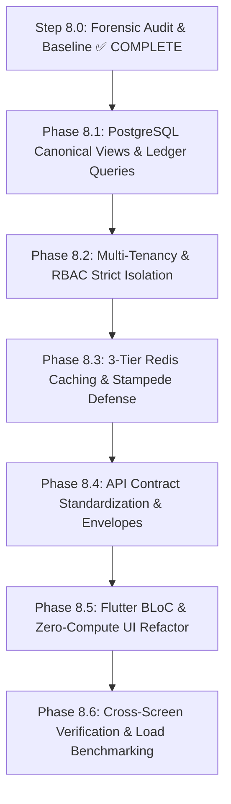

# PROPKART — STEP 8 KPI & REPORTING ARCHITECTURE IMPLEMENTATION ROADMAP
**Step:** 8.0 — Baseline & Canonical Definition Audit  
**Version:** 1.0.0  
**Date:** October 20, 2026  
**Role:** Lead Data Architect + KPI/Analytics Architect + Systems Auditor  
**Status:** CANONICAL IMPLEMENTATION ROADMAP  

---

## 1. Executive Roadmap Overview

Step 8.0 identified the root causes of KPI divergence across PropKart: mutable state-machine queries, non-standardized Redis keys, missing cache tiers, and client-side Flutter in-memory recalculations.

To systematically eliminate these defects without destabilizing production, Step 8 execution is divided into **6 sequential, gated implementation phases (8.1 through 8.6)**:



---

## 2. Phase-by-Phase Implementation Specifications

### Phase 8.1: PostgreSQL Canonical Views & Ledger Queries
**Objective:** Establish PostgreSQL as the single, authoritative mathematical authority for all PropKart business metrics.
- **Key Deliverables:**
  1. Author migration creating canonical database views:
     - `vw_kpi_site_visits_canonical`: Computes completed and scheduled visits strictly from `public.site_visits`.
     - `vw_kpi_pipeline_funnel_canonical`: Unified breakdown of leads and requirements.
     - `vw_kpi_inventory_summary`: Real-time stock counts by status, listing type, and creator role.
  2. Deprecate and remove all queries using `requirements.status = 'Site Visit Done'`.
  3. Formalize disambiguation between Converted Clients (`leads.stage = 'WON'`) and Closed Deals (`requirements.status = 'Won'`).
  4. Unify soft-delete guards (`deleted_at IS NULL` on entities; no soft-delete on append-only ledgers).
- **Gate Criteria:** Read-only PostgreSQL verification confirms 100% agreement between the new views and historical event ledgers.

---

### Phase 8.2: Multi-Tenancy & RBAC Strict Isolation
**Objective:** Guarantee zero cross-tenant data leakage and enforce strict role-scoped metrics.
- **Key Deliverables:**
  1. Purge all instances of `(organization_id IS NULL OR organization_id = $1)` from backend query builders. Replace with mandatory `organization_id = $tenantId`.
  2. Implement backend tenancy middleware that injects `tenantId` into all repository queries.
  3. Enforce role-based workspace scoping:
     - Telecaller: `organization_id = $tenantId AND assigned_telecaller_id = $userId`
     - Sales: `organization_id = $tenantId AND (assigned_to = $userId OR created_by = $userId)`
     - Admin: `organization_id = $tenantId`
- **Gate Criteria:** Automated multi-tenant isolation tests verify that Tenant A cannot observe any counts or records from Tenant B.

---

### Phase 8.3: 3-Tier Redis Caching & Single-Flight Stampede Defense
**Objective:** Eliminate raw aggregation database queries on mobile wake-up while guaranteeing sub-10ms response latency and cache coherence.
- **Key Deliverables:**
  1. Adopt the canonical Step 3 Redis Key Standard:
     ```text
     propkart:{env}:{tenantId}:kpi:{metricName}:{scope}:{dateHash}:v1
     ```
  2. Wrap `KpiService.getDashboardKpis` and `ReportsService.getBusinessInsightSummary` in `cacheService.getOrSet` with a 180-second TTL.
  3. Deploy single-flight mutex locks (stampede shield) so concurrent morning logins trigger exactly 1 database query.
  4. Standardize cache invalidation hooks:
     - Webhook lead ingest -> Invalidate `...:kpi:total_leads:*`
     - Telecaller lead reassignment -> Invalidate `...:kpi:telecaller_workload:*`
     - Site visit completion -> Invalidate `...:kpi:site_visits:*`
     - Deal won update -> Invalidate `...:kpi:deals_won:*`
  5. Fix key mismatch between `users.service.js` and `dashboard.service.js`.
- **Gate Criteria:** Cache hit ratio exceeds 90%; cache hit response latency is < 10ms.

---

### Phase 8.4: API Contract Standardization & Response Envelopes
**Objective:** Establish unified, strongly typed JSON API response contracts with freshness metadata.
- **Key Deliverables:**
  1. Attach standard metadata envelopes to all KPI endpoints:
     ```json
     {
       "success": true,
       "metric": "kpi_summary",
       "scope": "organization_wide",
       "date_range": "2026-10-14_to_2026-10-21",
       "calculated_at": "2026-10-20T15:00:00.000Z",
       "ttl_seconds": 180,
       "data": { ... }
     }
     ```
  2. Deprecate conflicting response keys (e.g. `accurateSiteVisitDone` vs `leads_page_kpis.site_visit_done` within the same JSON payload).
  3. Ensure all date inputs and outputs enforce Indian Standard Time (`+05:30`) ISO 8601 formatting.
- **Gate Criteria:** All API responses adhere strictly to the Step 4 API contract standards.

---

### Phase 8.5: Flutter BLoC & Zero-Compute Presentation Refactor
**Objective:** Eliminate all client-side array recalculations, ensuring Flutter widgets operate purely as declarative rendering surfaces.
- **Key Deliverables:**
  1. `campaign_leads_screen.dart`: Remove in-memory list filtering and `.length` calculations. Bind header badges and tab badges directly to backend summary DTOs.
  2. `telecaller_dashboard_screen.dart`: Remove `_openLeadsKpiCount` fallback to `IntegrationService().leads.length`. Consume authoritative counts from BLoC state.
  3. `sales_dashboard_screen.dart`: Remove client-side follow-up categorization loops. Bind directly to backend `followupsCategorized` counts.
  4. Render subtle freshness indicators (*"Updated 2m ago"*) utilizing backend `calculated_at` metadata.
- **Gate Criteria:** Zero `.where().length` operations found in Flutter widget `build()` methods.

---

### Phase 8.6: Cross-Screen Verification, Automated Tests & Load Benchmarks
**Objective:** Verify end-to-end mathematical consistency across all screens under peak simulated concurrency.
- **Key Deliverables:**
  1. Author automated end-to-end integration tests:
     - `test/kpi/cross_screen_kpi_parity_test.dart`: Asserts that Admin Dashboard Site Visits equals Reports Site Visits.
     - `test/kpi/multi_tenant_kpi_isolation_test.dart`: Asserts zero cross-tenant leakage.
  2. Run concurrent load benchmarks (50 concurrent users refreshing dashboard) to verify that single-flight caching holds and DB CPU remains < 15%.
  3. Complete Step 8 Final Sign-Off Report.
- **Gate Criteria:** 100% test pass rate across all new and existing test suites; 0 compilation errors; 0 cross-screen divergence.

---

## 3. Risk Mitigation & Rollback Strategy

1. **Database Backward Compatibility:**
   - Canonical views will be added alongside existing tables. No table columns will be renamed or dropped.
   - Legacy endpoints will be routed through canonical views, preserving backward compatibility for older mobile app builds.
2. **Redis Failover Safety:**
   - If Redis becomes unavailable, the caching layer automatically falls through to the canonical PostgreSQL view without crashing or throwing 500 errors.
3. **Rollback Mechanism:**
   - All schema changes will include explicit rollback scripts (`down.sql`).
   - Configuration flags (`ENABLE_CANONICAL_KPI_VIEWS=true`) will allow instant hot-swapping between legacy and canonical query engines.
