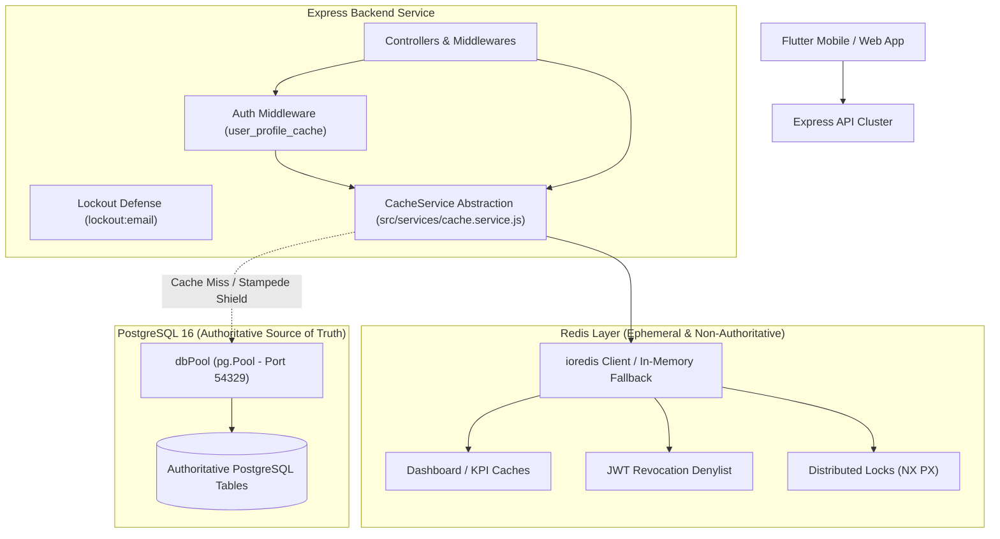

# PROPKART — REDIS ARCHITECTURE & CACHING FOUNDATION
**Version:** 1.0.0  
**Status:** CANONICAL CACHE SPECIFICATION (STEP 3)  
**Date:** October 20, 2026  
**Scope:** Distributed Caching, Ephemeral State, Rate Limiting & Coordination  

---

## 1. Executive Summary & The Prime Architectural Law

In Step 3, Redis is introduced to the PropKart platform strictly as an **ephemeral performance acceleration and coordination layer**.

Under no circumstances does Redis become the primary system of record.

```
================================================================================
                    THE PRIME DATA-LAYER ARCHITECTURAL LAW
================================================================================
         PostgreSQL 16                      Redis 7 / Ephemeral Store
               ↓                                        ↓
  AUTHORITATIVE BUSINESS DATA               CACHE / TEMPORARY STATE / COORDINATION
  - Single Source of Truth                  - Cache-Aside Query Results
  - ACID Relational Consistency             - Rate Limiting Windows
  - Immutable Event Ledgers                 - Ephemeral Security Tokens (Denylist)
  - Permanent Multi-Tenant Store            - Distributed Coordination & Locks
================================================================================
```

### 1.1 Non-Negotiable Tenets
1. **Zero Permanent Data Loss on Redis Flushes:** If Redis crashes, restarts, or runs `FLUSHALL`, **zero business data is lost**. The application continues serving requests by falling back gracefully to PostgreSQL.
2. **PostgreSQL Write-First Rule:** Every state mutation (`INSERT`, `UPDATE`, `DELETE`) is committed to PostgreSQL first. Redis keys are subsequently invalidated. We **never** write to Redis first and defer PostgreSQL writes.
3. **Graceful Degradation:** A complete Redis outage degrades system performance to baseline database speeds, but **must never cause application crashes or HTTP 500 errors for read operations**.

---

## 2. Layered Architecture & Responsibilities



---

## 3. Allowed vs Forbidden Redis Storage

To prevent architectural drift, the following classification is strictly enforced:

### 3.1 What Redis is ALLOWED to Store
- **1. Cache-Aside Projections:** Serialized query results from PostgreSQL (`dashboard_summary`, canonical KPI aggregations, property catalog filters, configuration lookups).
- **2. Ephemeral Security Tokens:** JWT revocation denylist (`jwt:deny:{jti}`), active refresh token rotation families (`jwt:refresh:{hash}`), and failed login attempt rate counters (`lockout:email:{email}`).
- **3. Distributed Coordination Primitives:** Mutex locks (`propkart:lock:{resource}`) to coordinate background sync tasks and prevent duplicate concurrent job execution.
- **4. Single-Flight In-Flight Promises:** In-memory request deduplication maps to prevent cache stampedes on expensive database queries.

### 3.2 What Redis is FORBIDDEN to Store
- **1. Primary Business Entities:** Customer leads, properties, BHK requirements, site visits, and scheduled follow-ups must **NEVER** originate or reside solely in Redis.
- **2. Historical Audit Ledgers:** `lead_status_history`, `lead_assignment_history`, and `audit_logs` must be written directly to PostgreSQL via `withTransaction`.
- **3. User Account Credentials:** Passwords, password hashes, and encryption keys are strictly forbidden from raw Redis caching.
- **4. Financial or Brokerage Records:** Commission structures, payment receipts, and contract terms must never be stored in Redis.

---

## 4. Failure Mode Principles

| Failure Scenario | Engine Behavior | Application Impact |
| :--- | :--- | :--- |
| **Redis Connection Timeout** | `ioredis` command timeout triggers (2,000 ms). | `CacheService` catches error, logs warning, and executes direct PostgreSQL query. Client request succeeds. |
| **Redis Completely Offline** | Reconnect retry strategy engages with exponential backoff; memory fallback activates. | System operates in degraded performance mode (uncached). Zero HTTP 500 crashes. |
| **Redis Out-Of-Memory (OOM)** | Max payload protection rejects >512 KB writes; Redis eviction policy (`volatile-lru`) evicts oldest TTL keys. | Less frequently accessed dashboards expire early; database absorbs reads. |
| **Cache Corruption / Bad JSON** | `JSON.parse()` error caught inside `CacheService.get()`. | Corrupted key purged; fresh data fetched from PostgreSQL and rewritten. |
