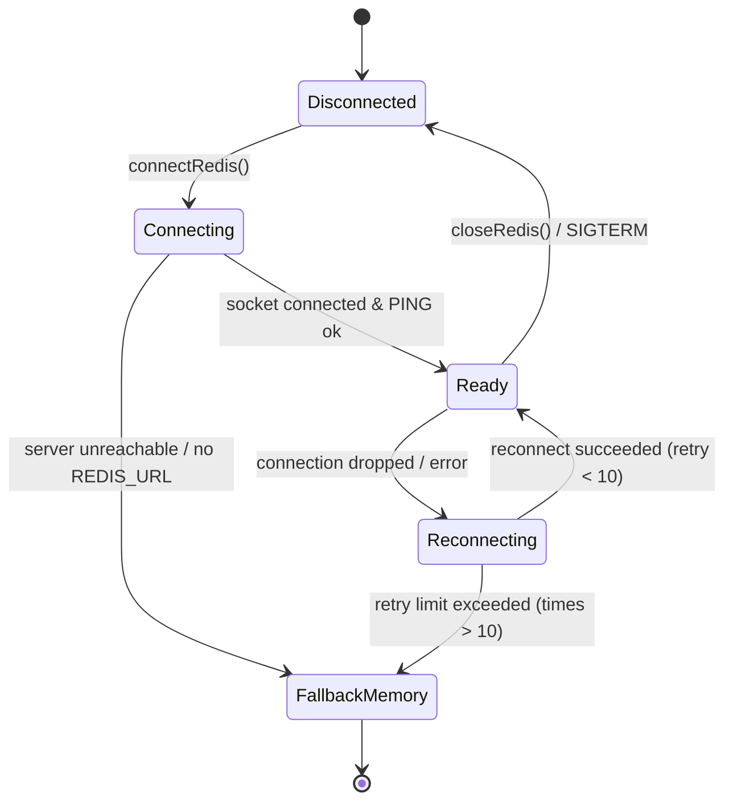

# PROPKART — REDIS CONNECTION ARCHITECTURE & RESILIENCE
**Version:** 1.0.0  
**Status:** CANONICAL CACHE SPECIFICATION (STEP 3)  
**Date:** October 20, 2026  
**Scope:** Redis Client Architecture, Connection Lifecycle, Reconnect Policies & Failover  

---

## 1. Executive Summary & Client Selection

In Step 3, PropKart standardized on **`ioredis`** as its enterprise Redis client library. 

`ioredis` was chosen over alternative drivers because it provides:
1. **Built-in Socket Resilience:** Native exponential backoff reconnect logic.
2. **Transparent Command Timeout Enforcement:** Prevents worker thread hanging on saturated Redis instances.
3. **Non-Blocking Key Scans:** High-performance `scanStream` implementation for prefix-based invalidation.
4. **Dual-Mode Graceful Fallback:** Completely decouples application boot from Redis availability.

---

## 2. Configuration & Parameter Matrix

All Redis connection parameters are centrally configured via environment variables with hardened defaults:

```
========================================================================================================================
                                REDIS CONNECTION HARDENING SPECIFICATION
========================================================================================================================
  Parameter                      Configured Value        Operational Purpose
------------------------------------------------------------------------------------------------------------------------
  Connection URL / Host          REDIS_URL / REDIS_HOST  Direct socket or TLS cluster endpoint
  Port                           6379 (Default)          Standard Redis port (configurable via REDIS_PORT)
  Connection Timeout             5,000 ms (5s)           Fast-fails initial connection attempt if server is unreachable
  Command Timeout                2,000 ms (2s)           Cancels individual Redis commands exceeding 2s, falling back to DB
  Max Retries Per Request        3 Retries               Prevents offline command queue accumulation in memory
  Ready Check                    Enabled                 Verifies server is ready to accept commands before routing traffic
  Max Reconnection Retries       10 Retries              Switches to in-memory fallback if server is down permanently
  Reconnection Backoff           50 ms to 2,000 ms       Exponential backoff with jitter to prevent server reconnection floods
========================================================================================================================
```

---

## 3. Reconnect Strategy & Lifecycle State Machine



### 3.1 Exponential Backoff Algorithm
When connection to Redis is lost, `ioredis` engages the custom retry strategy implemented in `src/config/redis.js`:
```javascript
retryStrategy(times) {
    if (times > 10) {
        logger.warn(`[Redis] Reconnect retry limit reached (${times}). Falling back to memory.`);
        return null; // Stop retrying, switch to resilient fallback
    }
    const delay = Math.min(times * 100, 2000);
    return delay;
}
```

---

## 4. Environment Isolation Standards

To ensure complete isolation across infrastructure environments:

| Environment | Redis Driver Mode | Endpoint / URL | Key Prefix Standard |
| :--- | :--- | :--- | :--- |
| **Local Development** | In-Memory Fallback (or Local Redis) | `redis://127.0.0.1:6379` (Optional) | `propkart:dev:` |
| **Automated Testing** | In-Memory Fast Mock | `none` (zero external network dependency) | `propkart:test:` |
| **Staging** | Distributed Redis Cluster | `rediss://staging-redis.internal:6379` | `propkart:staging:` |
| **Production** | High-Availability Redis + TLS | `rediss://prod-redis.internal:6379` | `propkart:prod:` |

---

## 5. Health Checking & Lifecycle API

The connection adapter in `src/config/redis.js` exports canonical health and lifecycle probes:

### 5.1 Health Check Probe (`checkRedisHealth()`)
```javascript
import { checkRedisHealth } from "./config/redis.js";

const health = await checkRedisHealth();
// Returns:
// {
//   status: "READY" | "FALLBACK_MEMORY" | "DEGRADED",
//   clientType: "ioredis" | "in-memory",
//   latencyMs: 1.45,
//   keysCount: 12
// }
```

### 5.2 Graceful Shutdown (`closeRedis()`)
Integrated into Express `SIGTERM` and `SIGINT` lifecycle hooks:
```javascript
process.on("SIGTERM", async () => {
    logger.info("Gracefully closing Redis client sockets...");
    await closeRedis();
    process.exit(0);
});
```
This ensures zero open sockets or uncommitted write pipelines upon container redeployment.
