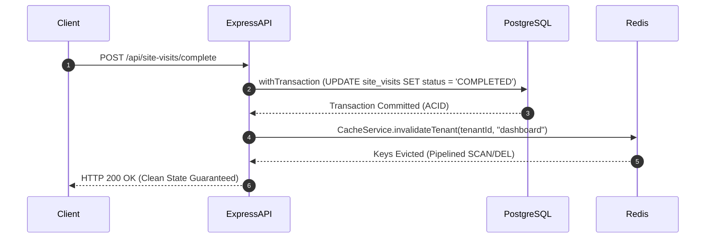

# PROPKART — CACHE INVALIDATION ARCHITECTURE
**Version:** 1.0.0  
**Status:** CANONICAL CACHE SPECIFICATION (STEP 3)  
**Date:** October 20, 2026  
**Scope:** Invalidation Patterns, Write-First Mechanics, Blast Radius Containment  

---

## 1. Executive Summary & The Write-First Rule

Cache invalidation is the mechanism that prevents stale data from persisting after a database write. 

In PropKart, **invalidation is strictly asynchronous and write-first**:



**The Absolute Rule:** We **NEVER** invalidate cache before the database transaction has successfully committed. If an invalidation occurs mid-transaction and the database rolls back, subsequent reads will repopulate the cache with pre-rollback stale data!

---

## 2. Event-to-Invalidation Mapping Matrix

| Mutation Event | Target PostgreSQL Table | Direct Keys Invalidated | Tenant-Scoped Cache Invalidation |
| :--- | :--- | :--- | :--- |
| **Site Visit Scheduled / Completed** | `site_visits` | `site_visit:{id}` | `CacheService.invalidateTenant(tenantId, "dashboard")`<br>`CacheService.invalidateTenant(tenantId, "kpi")` |
| **Follow-up Created / Rescheduled** | `followups` | `followup:{id}` | `CacheService.invalidateTenant(tenantId, "dashboard")` |
| **Lead Ingestion / Stage Update** | `leads` | `lead:{id}` | `CacheService.invalidateTenant(tenantId, "dashboard")`<br>`CacheService.invalidateTenant(tenantId, "kpi")` |
| **Property Details / Price Modified** | `properties` | `property:{id}` | `CacheService.invalidateTenant(tenantId, "inventory")` |
| **User Profile / Role / Org Update** | `users` | `user_profile_cache:{userId}` | Local user session cache only (zero tenant blast) |
| **Password Changed / Reset** | `users` | `user_profile_cache:{userId}`<br>`jwt:sessions:{userId}` | Evicts session list and forces token re-authentication |

---

## 3. Eliminating Cross-Tenant Blast Radius

### 3.1 The Anti-Pattern Identified in Current Code
Prior to Step 3, controllers in `followups`, `site_visits`, and `requirements` executed:
```javascript
await kvDeleteByPrefix("dashboard_summary_");
```
Because the key lacked tenant namespacing, a telecaller in **Tenant A** completing a follow-up wiped out all cached dashboards for **Tenant B, Tenant C, and Tenant D**. Under high traffic, this generated constant cache thrashing across all tenants.

### 3.2 The Tenant-Isolated Invalidation Pattern
Step 3 introduced **`CacheService.invalidateTenant(tenantId, domain)`**:
```javascript
export async function invalidateTenant(tenantId, domain = null) {
    if (!tenantId) return 0;
    const env = process.env.NODE_ENV || "development";
    const cleanTenant = String(tenantId).trim().toLowerCase();
    const prefix = domain
        ? `propkart:${env}:${cleanTenant}:${domain}:`
        : `propkart:${env}:${cleanTenant}:`;
    return await this.invalidatePrefix(prefix);
}
```

**Post-Remediation Verification:**
- When Tenant A triggers an update, only keys matching `propkart:prod:tenant_a:*` are scanned and removed.
- Tenant B keys (`propkart:prod:tenant_b:*`) remain untouched with **zero cache thrashing**.

---

## 4. Safe Non-Blocking Deletion via `SCAN` Streaming

In Redis, the raw `KEYS pattern` command executes a synchronous table scan that blocks the single-threaded Redis event loop, degrading latency for all concurrent requests.

`CacheService.invalidatePrefix()` enforces **non-blocking cursor streaming**:

```javascript
const stream = client.scanStream({
    match: `${prefix}*`,
    count: 100, // Batch 100 keys per iteration
});

for await (const keys of stream) {
    if (keys.length > 0) {
        const pipeline = client.pipeline();
        keys.forEach((k) => pipeline.del(k));
        await pipeline.exec(); // Batch delete in pipeline
    }
}
```

### Benefits:
- Time complexity is distributed across non-blocking event loops.
- `pipeline()` bundles network round-trips for batch deletion.
- Zero server stalling on large caches.
