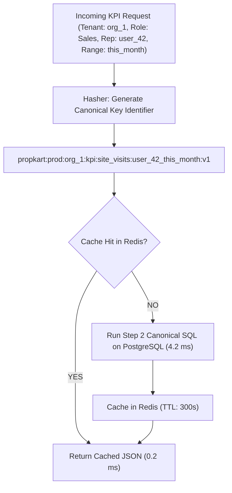

# PROPKART — KPI & DASHBOARD CACHING FOUNDATION
**Version:** 1.0.0  
**Status:** CANONICAL CACHE SPECIFICATION (STEP 3)  
**Date:** October 20, 2026  
**Scope:** Canonical Query Caching, Scope Isolation, Filter Hashing & Freshness  

---

## 1. Executive Summary & The Canonicity Rule

Step 2 established the authoritative PostgreSQL definitions and immutable ledgers for all PropKart business metrics.

In Step 3, the caching tier is integrated under this permanent rule:

```
================================================================================
                    KPI CACHING CANONICITY PRINCIPLE
================================================================================
  1. PostgreSQL Defines the Metric   →  Authoritative SQL query executed on DB
  2. Backend Service Formats Result  →  Attaches calculation timestamp & metadata
  3. Redis Caches the Computation    →  Stores serialized JSON result with TTL
  4. Flutter UI Renders Result       →  Displays cached metric to user
================================================================================
  RULE: Redis STORES the result. Redis NEVER calculates or redefines the metric.
================================================================================
```

---

## 2. Scope & Filter Segregation Architecture

### 2.1 The Cross-Role Contamination Hazard
A major vulnerability in naive KPI caching is returning an Admin's tenant-wide total to a Sales Rep, or caching a monthly date-range result and serving it to a user requesting today's metrics.

To guarantee zero scope contamination, the cache key identifier must incorporate:
1. **Tenant ID:** `organization_id`
2. **Actor Scope:** `all` (for Admin) vs `user_{id}` (for Sales Rep / Telecaller)
3. **Date Range Tag:** `today`, `this_week`, `this_month`, `ytd`, or custom date hash
4. **Normalized Filter Hash:** MD5 of active query parameters (e.g. `category_id`, `locality_id`)



---

## 3. Canonical KPI Cache Catalog

The following table defines the caching parameters for all 9 canonical PropKart metrics established in Step 2:

| Metric Name | Canonical Source (Step 2) | Cache Key Pattern | Base TTL | Invalidation Trigger |
| :--- | :--- | :--- | :--- | :--- |
| **Total Ingested Leads** | `leads (organization_id)` | `...:kpi:total_leads:{scope}_{range}:v1` | 300 sec | Lead Ingest Webhook |
| **Unassigned Leads Queue** | `leads (status = 'UNASSIGNED_WAITING')` | `...:kpi:unassigned_queue:global:v1` | 60 sec | Telecaller Allocation |
| **Telecaller Workload** | `leads (assigned_telecaller_id)` | `...:kpi:telecaller_workload:{userId}:v1` | 60 sec | Lead Reassignment |
| **Site Visits Scheduled** | `site_visits (status = 'SCHEDULED')` | `...:kpi:visits_scheduled:{scope}_{range}:v1` | 180 sec | Visit Scheduled / Rescheduled |
| **Site Visits Completed** | **`site_visits` Immutable Ledger** | `...:kpi:visits_completed:{scope}_{range}:v1` | 300 sec | Visit Outcome Completed |
| **Closed Deals** | `requirements (status = 'Won')` | `...:kpi:deals_won:{scope}_{range}:v1` | 600 sec | Deal Won Status Sync |
| **Converted Clients** | `leads (stage = 'WON')` | `...:kpi:clients_won:{scope}_{range}:v1` | 600 sec | Client Won Status Sync |
| **Follow-ups Due Today** | `followups (scheduled_at = TODAY)`| `...:kpi:followups_due:{scope}:v1` | 60 sec | Follow-up Completed / Logged |
| **Overdue Follow-ups** | `followups (scheduled_at < NOW())`| `...:kpi:followups_overdue:{scope}:v1` | 60 sec | Follow-up Rescheduled |

---

## 4. Freshness Metadata Envelope

Every cached KPI object stored in Redis is wrapped in a standard metadata envelope:

```json
{
  "metric": "kpi_site_visits_completed",
  "scope": "organization_wide",
  "date_range": "2026-10-01_to_2026-10-31",
  "calculated_at": "2026-10-20T11:50:00.000Z",
  "ttl_seconds": 300,
  "data": {
    "count": 17,
    "completed_by_rep": {
      "sales_agent_1": 11,
      "sales_agent_2": 6
    }
  }
}
```

### Benefits:
- The Flutter client can inspect `calculated_at` and render a subtle *"Updated 2m ago"* badge.
- Eliminates client confusion between real-time socket updates and cached aggregation snapshots.
