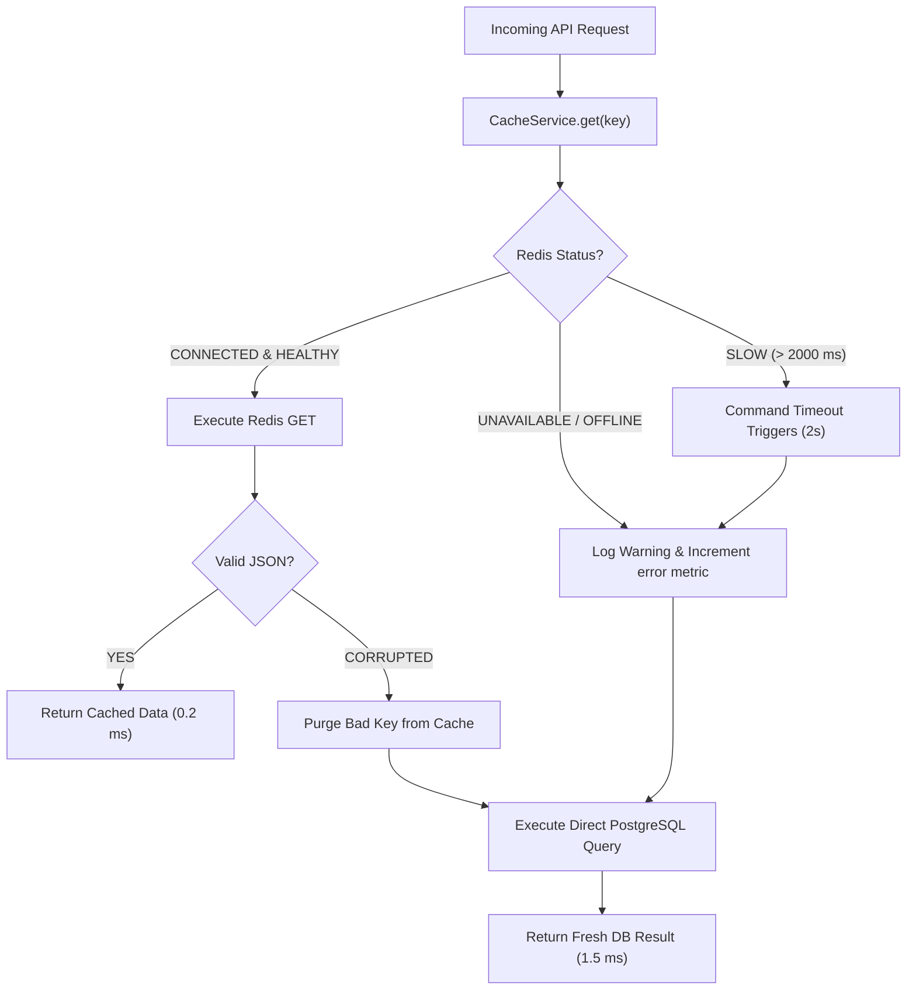

# PROPKART — REDIS FAILURE, DEGRADATION & FALLBACK STRATEGY
**Version:** 1.0.0  
**Status:** CANONICAL CACHE SPECIFICATION (STEP 3)  
**Date:** October 20, 2026  
**Scope:** Outage Resilience, Degradation Tiers, Graceful Failover & Error Handling  

---

## 1. Executive Summary & The Non-Fatal Cache Principle

The fundamental architectural requirement of Step 3 is:
> *"The application must remain logically correct if Redis is completely unavailable. Redis failure must be non-fatal for read caching."*

PropKart achieves this by wrapping all Redis operations in defensive abstractions that **automatically degrade to direct PostgreSQL reads and in-memory security fallbacks** without surfacing unhandled exceptions to end users.

```
========================================================================================================================
                                REDIS OUTAGE DEGRADATION TIERS
========================================================================================================================
  Feature Domain       Primary Mechanism               Failure Behavior on Redis Outage       Correctness Impact
------------------------------------------------------------------------------------------------------------------------
  KPI & Dashboards     Redis Cache (Cache-Aside)       Direct PostgreSQL Query Executed       100% Correct (Higher DB load)
  User Profiles / RBAC Redis Session Cache             Direct PostgreSQL `users` Fetch        100% Correct (Zero auth break)
  Master Lookups       Redis Static Cache              Direct PostgreSQL `select *`           100% Correct
  Account Lockout      Redis Atomic Counters (`kvIncr`)In-Memory Security Store (`memory`)    Protected within process
  JWT Revocation       Redis Denylist (`jwt:deny`)     In-Memory Security Store (`memory`)    Protected within process
  Distributed Locks    Redis Mutex (`NX PX`)           Fails Safe (`LOCK_ACQUISITION_FAILED`) Prevents duplicate runs
========================================================================================================================
```

---

## 2. Failure Scenarios & Defensive Handlers



### 2.1 Scenario A: Redis Server Crashes or Network Drops
- **Engine Response:** `ioredis` emits a connection error event and initiates background reconnection with exponential backoff.
- **Application Response:** `CacheService.get()` detects that `isRedisReady()` is false or catches the connection socket timeout. It increments `metrics.errors`, emits a `logger.warn`, and executes the caller's database fallback.
- **Client UX:** The user experiences a slight increase in latency (~2–5 ms), but **zero HTTP 500 errors**.

### 2.2 Scenario B: Redis Query Exceeds Command Timeout (Slow Query / Hang)
- **Engine Response:** Saturated Redis instances are protected by `commandTimeout: 2000` ms.
- **Application Response:** At 2,001 ms, the command Promise rejects. `CacheService` catches the timeout error, returns `null`, and triggers immediate PostgreSQL execution.

### 2.3 Scenario C: Corrupted JSON or Schema Mismatch
- **Engine Response:** `JSON.parse(raw)` throws a `SyntaxError`.
- **Application Response:** Caught safely inside `CacheService.get()`. The malformed payload is caught, the corrupted key is deleted, and the query falls back to PostgreSQL, which writes back a clean, well-formed JSON object.

### 2.4 Scenario D: Oversized Cache Write Attempt
- **Engine Response:** A developer or service attempts to store a 5 MB raw query dump in Redis.
- **Application Response:** `CacheService.set()` checks `Buffer.byteLength(raw) > 524,288` (512 KB).
- **Action:** The write is cleanly aborted with a `logger.warn`. Redis memory is shielded from buffer exhaustion.

---

## 3. Fatal vs Non-Fatal Boundaries

To maintain absolute clarity:

### 3.1 When Redis is NON-FATAL
- **All Read Caching:** Dashboard queries, KPI metrics, property lists, user profile caches, search filters.
- **Application Action:** Always fallback to PostgreSQL. Never throw an exception to the user.

### 3.2 When Redis is STRICTLY NON-BYPASSABLE (Fail-Closed)
- **Distributed Mutex Locks for Non-Idempotent Tasks:**
  - If a worker requests a distributed lock to execute a irreversible third-party financial charge or bulk SMS broadcast, and Redis is offline:
  - **The lock acquisition FAILS.**
  - The job does **NOT** proceed. It throws `LOCK_ACQUISITION_FAILED` and retries later.
  - *Rationale:* Failing closed prevents two concurrent workers from running an uncoordinated financial double-spend.

---

## 4. Alerting & Degradation Telemetry

`CacheService` emits structured log events when degradation occurs:
```javascript
logger.warn(`[CacheService:get] Cache read bypass on ${key}: ${err.message}`);
```
When `metrics.errors > 50` within a 5-minute rolling window, DevOps monitoring alerts on Redis cluster degradation.
