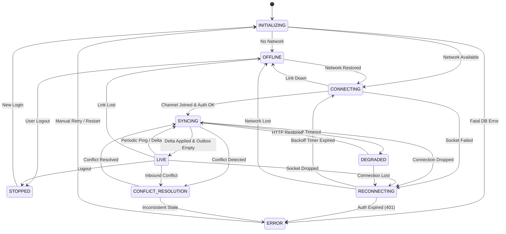

# PropKart Synchronization State Machine Specification

## 1. Overview & Formal Definition

The PropKart synchronization engine operates under a deterministic Finite State Machine (FSM). The FSM prevents concurrent duplicate sync operations, ensures safe recovery from network dropouts, manages outbox replay transitions, and protects data consistency during conflict arbitration.

---

## 2. Certified State Set

The FSM comprises exactly 10 discrete states:

```text
1. INITIALIZING        - Application boot, local Isar opening, auth credential loading.
2. OFFLINE             - Network unreachable; UI reads/writes exclusively against local Isar cache.
3. CONNECTING          - Network detected; establishing WebSocket channel and verifying JWT.
4. SYNCING             - Executing initial or delta sync, computing entity diffs, merging deltas.
5. LIVE                - Fully synchronized; bidirectional realtime channel open; steady state.
6. DEGRADED            - Network is partially degraded (e.g., WebSocket down, HTTP fallback operational).
7. RECONNECTING        - WebSocket or network dropped; executing exponential backoff timers.
8. CONFLICT_RESOLUTION - Multi-device concurrent mutation conflict detected; resolving via merge rules.
9. ERROR               - Fatal unrecoverable sync error (e.g., schema incompatibility, tenant breach).
10. STOPPED            - Synchronization intentionally paused (e.g., explicit user logout).
```

---

## 3. State Transition Matrix & Rules

| From State | Trigger / Event | Target State | Invariants & Pre-conditions |
| :--- | :--- | :--- | :--- |
| **INITIALIZING** | DB Open & Online | **CONNECTING** | Isar collections ready; auth token present. |
| **INITIALIZING** | DB Open & No Network | **OFFLINE** | Isar collections ready; network probe failed. |
| **INITIALIZING** | DB Corruption / Fatal | **ERROR** | Unrecoverable storage error. |
| **OFFLINE** | Network Reachable | **CONNECTING** | `NetworkInfo.isConnected` returns true. |
| **OFFLINE** | User Logout | **STOPPED** | Session cleared; outbox preserved. |
| **CONNECTING** | Socket Joined & Auth OK | **SYNCING** | Channel joined; delta sync initiated. |
| **CONNECTING** | Socket Connection Failed | **RECONNECTING** | Backoff timer started (`clamp(attempts*2, 2, 30)`s). |
| **CONNECTING** | Network Lost | **OFFLINE** | Network interface down. |
| **SYNCING** | Delta Merged & Outbox Clear | **LIVE** | All diffs applied to Isar; outbox empty. |
| **SYNCING** | Conflicting Mutations Detected | **CONFLICT_RESOLUTION**| Newer server edit detected during outbox replay. |
| **SYNCING** | Sync Request Timeout/Fail | **DEGRADED** | WebSocket open, but HTTP delta endpoints timing out. |
| **SYNCING** | Connection Drop | **RECONNECTING** | Abort pending diff transaction; retain checkpoint. |
| **LIVE** | Realtime Socket Dropped | **RECONNECTING** | Heartbeat missed or TCP reset. |
| **LIVE** | Network Interface Lost | **OFFLINE** | Wi-Fi/Cellular disconnected. |
| **LIVE** | Periodic Ping Delta Detected | **SYNCING** | 9s ping discovered server changes; incremental update. |
| **LIVE** | Conflict via Incoming Event | **CONFLICT_RESOLUTION**| Inbound event conflicts with uncommitted local edit. |
| **LIVE** | User Logout | **STOPPED** | Tear down socket, cancel timers. |
| **DEGRADED** | HTTP Endpoints Restored | **SYNCING** | Health check re-established full throughput. |
| **DEGRADED** | Socket Dropped | **RECONNECTING** | Fallback to reconnect loop. |
| **RECONNECTING** | Backoff Elapsed & Retrying | **CONNECTING** | Socket dial initiated. |
| **RECONNECTING** | Network Interface Lost | **OFFLINE** | Stop reconnect timer until interface is restored. |
| **RECONNECTING** | Max Retries / 401 Unauth | **ERROR** | Authentication permanently rejected or fatal retry limit. |
| **CONFLICT_RESOLUTION** | Field Merge / Winner Picked | **SYNCING** | Resolved entity committed to Isar; continue replay. |
| **CONFLICT_RESOLUTION** | Fatal Conflict Inconsistency | **ERROR** | Corrupted state requiring administrative audit. |
| **ERROR** | Manual Retry / App Restart | **INITIALIZING** | User-prompted recovery or clean restart. |
| **STOPPED** | User Logged In | **INITIALIZING** | New session authenticated. |

---

## 4. Forbidden Transitions & Invariants

To eliminate race conditions and data corruption, the following transition patterns are strictly rejected:

```text
❌ LIVE → LIVE
   (Duplicate concurrent sync workers are forbidden; no-op if already live).

❌ LIVE → SYNCING → LIVE (without acquiring reentrancy lock)
   (Background 9s ping must lock the sync worker; secondary triggers abort if ping is in progress).

❌ OFFLINE → LIVE
   (Must always transition through CONNECTING and SYNCING to reconcile offline outbox and catch-up deltas).

❌ ERROR → LIVE
   (Must pass through INITIALIZING and re-verify database integrity and session credentials).

❌ ANY → STOPPED (without canceling active timers)
   (All heartbeat and reconnect timers MUST be canceled upon entering STOPPED).
```

---

## 5. Visual State Transition Diagram



---

## 6. Implementation Reference

The state machine is implemented in `lib/core/network/sync_manager.dart` via:
- Canonical `enum SyncState { initializing, offline, connecting, syncing, live, degraded, reconnecting, conflictResolution, error, stopped }`
- Transition method: `bool transitionTo(SyncState newState, {String? reason})`
- Broadcast stream: `Stream<SyncState> get stateStream`
- Reentrancy locks guarding all delta and outbox processing.
